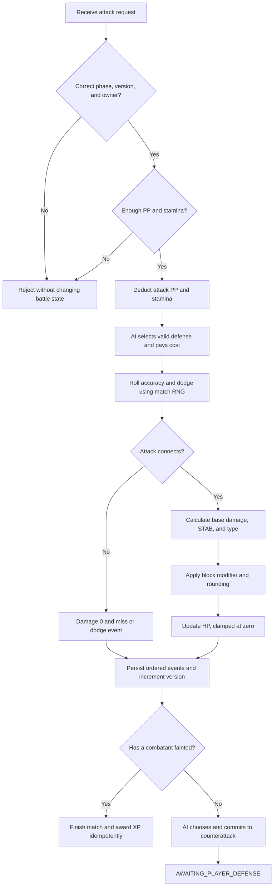
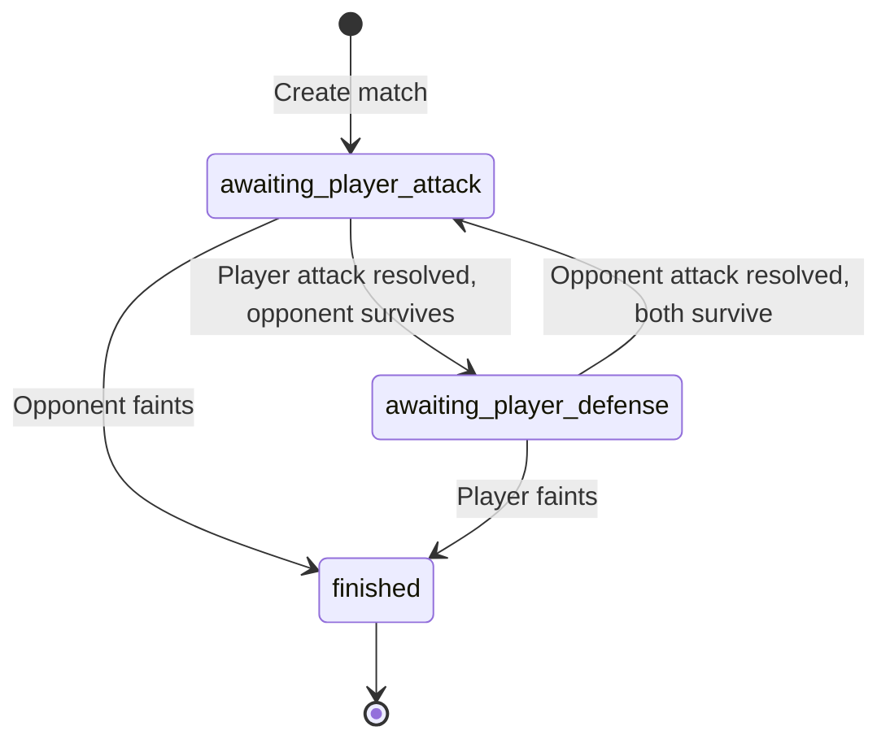
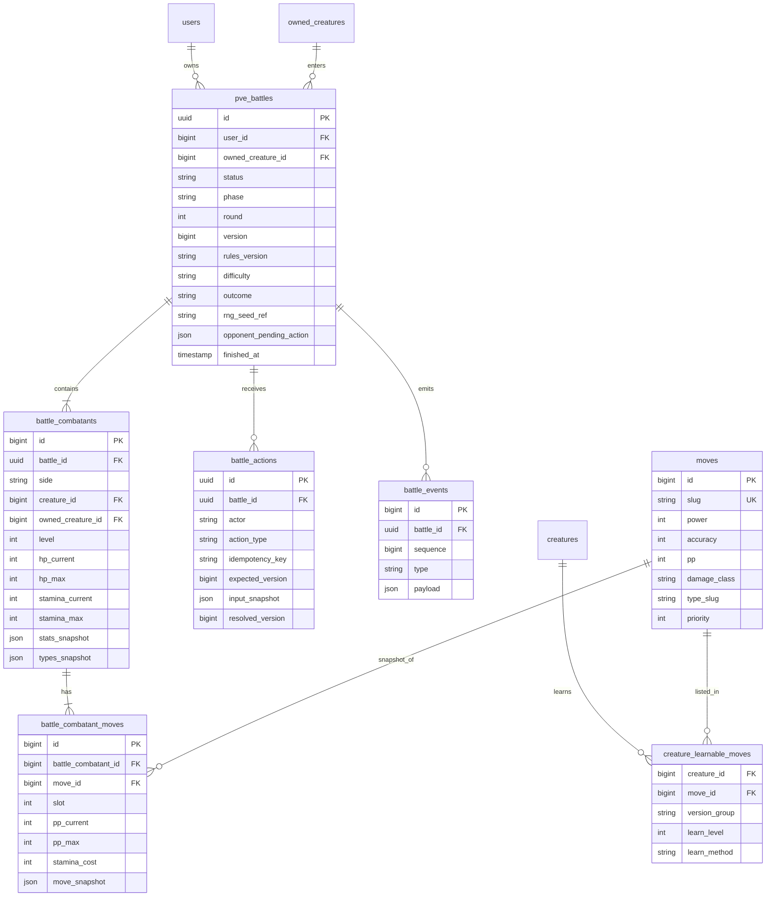
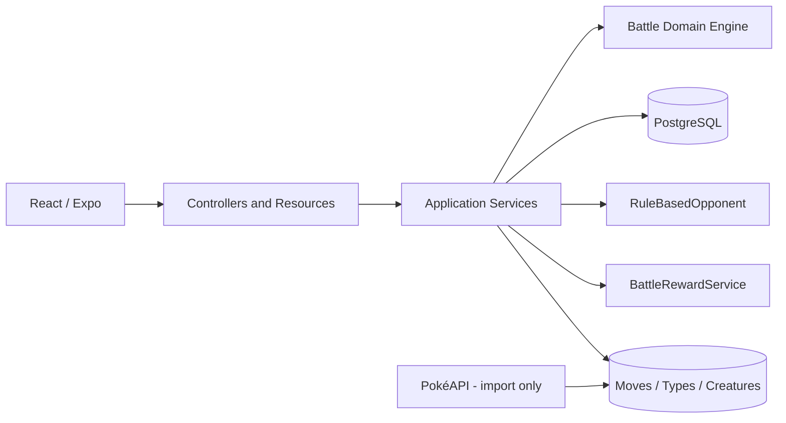

# Battle Arena — PvE Battle Engine Technical Specification

> **Architecture and gameplay design specification**  
> **Version:** `0.1.0-draft` · **Date:** 2026-11-25  
> **Target location:** `battle-arena-api/docs/BATTLE_ENGINE_PVE_SPEC.md`  
> **Scope:** 1v1 PvE, turn-based **attack-and-defensive-reaction** combat, Laravel REST API, React web, and Expo mobile.  
> **Status:** proposed implementation design. Values labeled **PROVISIONAL** require playtesting and explicit balancing approval.

## 0. Executive instructions for Cursor

Treat this document as the design contract for the next Battle Arena phase. Read the entire document before making changes.

- **Do not use WebSockets for the PvE MVP.** Use authenticated REST requests and a persisted server-authoritative state machine.
- **Do not rebuild** the National Dex catalog, authentication, player profiles, personal collection, trainer levels, or existing XP policies.
- **The player attacks first.** The opponent AI selects a defensive reaction; the server resolves that exchange. If it survives, the AI commits to a counterattack and the player chooses a defensive reaction.
- Keep **base stats, move Power, PP, stamina, HP, and trainer XP** separate. PokéAPI provides base stats, Power, PP, and move metadata, but not universal stamina, remaining combat resources, or battle outcomes.
- Every state transition must be **authoritative, atomic, idempotent, replayable, and testable**.
- The server emits **structured battle events**. Frontends animate them but never calculate authoritative damage, choose outcomes, or award XP.
- Update public **Game Rules** in all five locales (`en`, `fr`, `pt-BR`, `it`, `es`) and distinguish shipped functionality from planned functionality.
- Follow repository `.cursor/rules/*.mdc`, keep controllers thin, preserve compatibility, and report actual tests. **Do not commit or push automatically.**

### 0.1 Existing product versus this phase

| Already exists | To build in this phase |
|---|---|
| Laravel 13, PostgreSQL, Redis, Sanctum, and player profiles | Persistent PvE matches and deterministic turn resolution |
| Local National Dex catalog, artwork references, and evolutions | Controlled move subset, type relations, move loadouts |
| Personal collection and level-based selection allowances | Eligible **owned** creature selection for 1v1 combat |
| `BattleEligibilityPolicy` and `BattleRewardService` | Trusted result integration with idempotent XP payout |
| `GET /api/game/rules` and five-language i18n | Versioned PvE rules/feature flag, battle UI, event history |

> Verify the latest branches and actual existing contracts before implementation. This document is a target design, not a claim that the battle engine has already shipped.

---

## 1. Gameplay vision

Battle Arena's PvE combat is a sequence of **attacks and defensive reactions**. Each attack presents the defender with a meaningful choice. The attacker spends move resources; the defender decides how to respond; and the backend resolves accuracy, dodging, damage modifiers, HP, and effects. Both sides then exchange roles.

**The human player initiates the first exchange.** The National Dex contains a `speed` stat, but it **does not determine first-turn initiative in this MVP**. The attacker/defender sequence is a deliberate product rule. Move priority and dynamic turn order are deferred.

### 1.1 Design principles

1. **Strategy:** Attacks consume PP and stamina; defensive reactions also require thoughtful stamina management.
2. **Fairness:** AI and human combatants use the same costs, calculations, and restrictions.
3. **Consistency:** Persist match state in PostgreSQL using immutable snapshots of combat attributes and rule versions.
4. **Clarity:** Users should understand why an attack hit, missed, was dodged, was blocked, or dealt no damage due to immunity.
5. **Extensibility:** The core domain engine must not depend on HTTP, Eloquent, or the UI; it can be reused for future PvP.
6. **Reproducibility:** Identical starting state + actions + random sequence must produce identical results and events.

### 1.2 Out of scope for the PvE MVP

No PvP, WebSockets, mid-battle creature switching, multi-creature parties, items, weather, status conditions, passive abilities, multi-turn moves, multi-hit moves, item-based healing, capturing, or in-battle evolution. Leave well-defined extension points, but do not implement speculative systems.

---

## 2. Architecture diagrams and visual references

### 2.1 PvE arena wireframe


The SVG is a **layout reference only**. Its values are illustrative and are not evidence of a real playable match. Recreate the UI as real React and React Native components; do not use the image as an interactive background.

### 2.2 HP, stamina, and PP resource bars


### 2.3 Damage calculation breakdown


### 2.4 Attack resolution flowchart



### 2.5 HTTP sequence diagram (no WebSockets)

```mermaid
sequenceDiagram
    autonumber
    actor Player
    participant FE as React / Expo
    participant API as Laravel API
    participant BE as Battle Engine
    participant DB as PostgreSQL
    participant AI as Opponent Policy
    Player->>FE: Select owned creature
    FE->>API: POST /api/pve/battles
    API->>DB: Verify ownership; persist snapshots and match
    API-->>FE: Initial state; awaiting_player_attack
    Player->>FE: Choose Ember
    FE->>API: POST /api/pve/battles/{id}/attack + key + version
    API->>DB: Lock match; validate phase and request
    API->>AI: Select defense using actual resources
    AI-->>API: block
    API->>BE: Resolve attack vs. defense
    BE-->>API: New state and ordered events
    API->>AI: Choose next attack without knowing future defense
    API->>DB: Persist events, pending intent, updated version
    API-->>FE: Events, telegraph, awaiting_player_defense
    FE-->>Player: Animate damage and opponent intent
    Player->>FE: Choose dodge
    FE->>API: POST /api/pve/battles/{id}/defend + key + version
    API->>DB: Lock match and verify pending attack
    API->>BE: Resolve committed attack vs. chosen defense
    BE-->>API: New state and ordered events
    API->>DB: Persist outcome, close round, increment version
    API-->>FE: Events; awaiting_player_attack or finished
    FE-->>Player: Animate reaction and display next options
```

### 2.6 Match state machine



**Definition of a round:** One complete round consists of a player attack exchange followed, if the AI survives, by its counterattack exchange. A knockout ends the round immediately.

---

## 3. Source of truth: PokéAPI data versus the Battle Engine

| Concept | PokéAPI source | Laravel responsibility |
|---|---|---|
| Creatures, species, evolutionary stages | Pokémon / species / evolution catalog | Ownership, eligibility, combat snapshot |
| HP, Attack, Defense, Sp. Atk, Sp. Def, Speed | `pokemon.stats` base stats | Effective level-based stats; current HP |
| Learnable moves | `pokemon.moves`, `version_group_details` | Valid equipped moves, maximum four |
| Power, accuracy, PP, priority, damage category | `move` | Current PP, stamina costs, hit checks, damage and supported effects |
| Strengths, resistances, immunities | `type.damage_relations` | Match-specific multipliers, including dual types |
| Sprites and some cries | `pokemon.sprites`, `cries` | Presentation, fallback, licensed asset strategy |
| Stamina | **No universal stamina resource** | Current/maximum stamina, costs and restoration |
| Exact damage, remaining HP, winner | **Not calculated by PokéAPI** | Server-authoritative state, outcomes, events and trainer XP |

**Integration boundary:** Import only required data through idempotent commands/jobs. Public catalog requests and live battles must **never** call PokéAPI. Keep external providers behind contracts and DTOs. Do not commit copyrighted sprite binaries to repositories. Review rights before publicly distributing a game that displays third-party art or audio.

### 3.1 MVP data subset

- Preserve the full National Dex and existing catalog API.
- Enable an initial configurable pool of approximately **20 stage-1 creatures** and **20 direct-damage moves**; expansion can happen later.
- Equip each combatant with **all supported legal moves** from their learnset for the pinned version/group (`game.pve.max_moves` may optionally soft-cap). Arena UIs scroll horizontally when the strip overflows.
- Start with `damage_class = physical|special`, positive `power`, valid/supported accuracy, and no complex secondary behavior. Defer status moves, multi-hit, recoil, special priority and advanced effects.
- Pin and document the ruleset and version/generation for imported move and type data; upstream values can differ by generation.
- A player must use an **owned, eligible creature**. Reuse existing acquisition/selection and trainer eligibility policies.

### 3.2 Example move metadata: Ember

| Field | Value | Source / meaning |
|---|---:|---|
| `power` | 40 | PokéAPI move value |
| `accuracy` | 100 | Base percentage |
| `pp_max` | 25 | Maximum uses |
| `pp_remaining` | 17 | **Illustrative match-state value** |
| `stamina_cost` | 15 | **PROVISIONAL Battle Arena rule** |
| `damage_class` | `special` | Uses Special Attack against Special Defense |

**Power 40 does not mean 40 HP damage.** Actual damage also depends on level, offensive/defensive stats, type effectiveness, reactions and rounding rules.

---

## 4. Battle rules — proposed v0.1 baseline

Everything in this section is a **provisional Battle Arena balancing proposal**, not an official PokéAPI mechanic. All rules must be versioned and enforced by the backend.

### 4.1 Resources

| Resource | Initial value | Purpose | When depleted |
|---|---|---|---|
| `HP` | Derived from species and effective level | Health | `0`: knockout and match end |
| `stamina` | **100 (PROVISIONAL)** | Shared budget for attacks and defensive reactions | Expensive actions become unavailable |
| `PP` | Individual PokéAPI move maximum | Caps uses per move | That move is unavailable |

- A valid attack spends **one PP and its stamina cost**, even if it misses or is dodged.
- Invalid commands never spend resources and never advance the match.
- HP and stamina are integers clamped to `[0, max]`; PP is clamped to `[0, pp_max]`.
- No passive stamina regeneration in the MVP. The active `recover` reaction is the only standard recovery mechanism, so the cost trade-off is understandable.
- Add a fallback **`basic_strike`** when none of the configured moves can be used, costing **zero PP and zero stamina**, with Power 20 and Normal typing. This is an original Battle Arena move, not a PokéAPI move. It still uses the normal damage formula and creates events. It prevents an unwinnable resource deadlock.
- The AI follows **exactly the same** resource restrictions as the player.

### 4.2 Attack stamina costs

For this initial version, stamina cost is part of the **snapshotted move definition** and comes from a configurable backend balance rule. Initial suggestion for direct-damage moves:

```text
staminaCost(power) = clamp(3 + 3 * ceil(power / 10), 10, 35)
Ember (power 40) => 15 stamina
```

Per-move overrides may replace the formula later. Save the effective cost in the match snapshot; never recalculate it using newer configuration during an already-started match.

### 4.3 Defensive reactions

| Defense (`defense_type`) | Stamina cost | **PROVISIONAL** effect |
|---|---:|---|
| `endure` | 0 | Take normal damage |
| `block` | 10 | Reduce incoming damage by **50%** |
| `dodge` | 20 | **60%** chance to avoid all damage; otherwise take normal damage |
| `recover` | 0 | Restore **15 stamina**, capped at maximum; take normal damage |

- Apply the defensive stamina cost or credit **exactly once per exchange**.
- `block` multiplies damage after offensive/type modifiers. Define and test rounding.
- Resolve normal accuracy first; if the move hits, resolve dodge. `attack_missed` and `defense_dodged` are separate results with zero damage.
- `recover` restores **stamina only**, not HP, PP or status. The defender is still exposed to normal incoming damage.
- If a player lacks stamina for `block` or `dodge`, return a validation error; `endure` and `recover` remain available.
- Events should distinguish `attack_missed`, `defense_dodged`, `damage_blocked`, `damage_applied` and `stamina_recovered`.

### 4.4 Attack order, accuracy and reactions

1. The human selects an attack and sends an intent to the API.
2. The API checks ownership, phase, expected version, PP and stamina.
3. **The AI selects a defense** based only on already-available information and match RNG.
4. The engine deducts valid costs, checks accuracy, checks dodge where relevant, and resolves damage.
5. If still alive, the AI **selects and persists its next move before** the player responds.
6. The API exposes a limited **telegraph** of the pending counterattack (for example, the attacking elemental type), rather than revealing every internal detail.
7. The human chooses a reaction; the engine resolves the **already-committed** enemy attack.
8. If both survive, a new round begins with another human attack.

**No cheating by the AI:** Define exactly which visible information the opponent policy can use. It must not inspect the player's future defense, unrevealed random results, or a decision not yet submitted.

### 4.5 Opponent AI difficulty

| Difficulty | Initial strategy | Constraints |
|---|---|---|
| `easy` | Weighted-random legal attacks and defenses | Never bypass PP/stamina restrictions |
| `normal` | Prefer expected damage and sensible blocking under threat | Add variation; never always choose the perfect reaction |
| `hard` | Later: weigh HP, stamina, type, KO risk, and opportunity cost | **No hidden stat/cost bonuses** |

Implement `easy` and `normal` first. Add `hard` only after gameplay is stable. Difficulty does **not** modify trainer XP rewards in this phase.

---

## 5. Damage formula, rounding, and worked examples

A proposed RPG-style damage formula (subject to tests and balance tuning):

```text
L = combatant's effective level
P = move.power
A = Attack or Special Attack based on damage_class
D = Defense or Special Defense based on damage_class

baseDamage = floor(( (2*L/5 + 2) * P * A/D )/50 + 2)
attackMultiplier = STAB * TYPE * RANDOM
modifiedDamage = floor(baseDamage * attackMultiplier)
finalDamage = floor(modifiedDamage * DEFENSE_MULTIPLIER)
finalDamage = clamp(finalDamage, 0, defender.current_hp)
```

For early integration tests, `RANDOM = 1` is acceptable. If gameplay randomness is enabled, use a deterministic per-match random source with a documented range (e.g., `0.90–1.00`). **Never use frontend randomness to determine authoritative outcomes.**

- Proposed same-type attack bonus **STAB = 1.5**, otherwise 1.
- `TYPE` is the product of effectiveness values against one or two defensive types. `TYPE = 0` means immunity and must always result in **zero damage**. Typical products include `0`, `0.25`, `0.5`, `1`, `2`, and `4`.
- `DEFENSE_MULTIPLIER`: `block = 0.5`, `endure = 1`, `recover = 1`, successful `dodge = 0`.
- Missing due to accuracy also deals zero damage.
- For nonimmune, successful attacks, define a minimum hit of 1 HP when the positive pre-clamp damage would otherwise round to zero. Never apply that minimum to misses, dodges or immunities.
- Apply the exact rounding and clamping order shown in the formula; use integer HP/PP/stamina, and ensure multiplier calculations are consistent across runtimes.
- Effective stats need a **versioned level-based formula**. Do **not** silently treat base stats as effective battle stats. A documented simplified formula without IVs, EVs or nature is acceptable for the MVP if saved in the match snapshot.

### 5.1 Worked damage breakdown

| Stage | Calculation | Result |
|---|---|---:|
| Base damage | Initial damage formula | 21 |
| Type advantage | `21 × 2` | 42 |
| AI blocks | `42 × 0.5` | **21 HP** |


This is an illustrative example, **not** a live PokéAPI-computed move. Assume `STAB = 1` and `RANDOM = 1` in this example.

### 5.2 Damage invariants

- Damage cannot be negative or greater than the target's current HP.
- Immunity supersedes every damage multiplier (`0` damage).
- A valid missed attack still spends its resources.
- `recover` cannot exceed maximum stamina.
- Combat stats and rules cannot change after a match begins.
- Identical seed and action sequence produce identical outcomes and event logs.

---
## 6. REST API contracts — proposed v0.1

**Base path:** `/api/pve/battles`. All routes require `auth:sanctum`; the API honors `Accept-Language`. Serialize outgoing data through Laravel API Resources. Stable JSON keys remain English; human-facing messages are translated.

| Method | Route | Responsibility |
|---|---|---|
| `POST` | `/api/pve/battles` | Start a match with an eligible owned creature |
| `GET` | `/api/pve/battles/{battleId}` | Retrieve the public match snapshot and current phase |
| `GET` | `/api/pve/battles/{battleId}/events?after=42` | Fetch ordered events for animation and resuming |
| `POST` | `/api/pve/battles/{battleId}/attack` | Perform player attack and resolve AI reaction |
| `POST` | `/api/pve/battles/{battleId}/defend` | Defend against the AI's pending committed attack |
| `GET` | `/api/me/pve/battles` | List the player's recent matches (optional for initial MVP) |

### 6.1 Start a match

```http
POST /api/pve/battles
Content-Type: application/json
Accept-Language: en

{"owned_creature_id":123,"difficulty":"normal"}
```

The backend verifies authentication, ownership, trainer eligibility for PvE (level 1+), a valid combat loadout, allowed match concurrency, and a configured opponent. **Never accept client-supplied combat stats, arbitrary species IDs, HP, or unlocked eligibility.** Create and persist match composition and immutable snapshots in a transaction.

### 6.2 Match state response (illustrative)

```json
{
  "data": {
    "id": "e6a6ce2d-39a2-4aa7-8d6e-9d1aafc8dd26",
    "mode": "pve",
    "status": "active",
    "phase": "awaiting_player_attack",
    "round": 1,
    "version": 1,
    "rules_version": "pve-0.1",
    "player": {
      "owned_creature_id": 123,
      "name": "Example Creature",
      "level": 5,
      "types": ["fire"],
      "hp": { "current": 72, "max": 100 },
      "stamina": { "current": 55, "max": 100 },
      "moves": [
        {
          "id": 10,
          "slug": "ember",
          "power": 40,
          "accuracy": 100,
          "type": "fire",
          "pp": { "current": 17, "max": 25 },
          "stamina_cost": 15,
          "can_use": true
        }
      ]
    },
    "opponent": {
      "name": "Example Opponent",
      "hp": { "current": 39, "max": 60 },
      "stamina": { "current": 70, "max": 100 },
      "intent": null
    },
    "allowed_actions": ["attack"],
    "last_event_sequence": 0
  }
}
```

This is a **proposed contract**, not a production response. Align field naming and resource wrapping with existing `CreatureResource` and `GameRulesResource`. The values are illustrative.

### 6.3 Submit an attack

```http
POST /api/pve/battles/e6a6ce2d-39a2-4aa7-8d6e-9d1aafc8dd26/attack
Idempotency-Key: c2fce8ea-9e2e-4e4b-89bc-4f8a202db9de
Content-Type: application/json

{"move_id":10,"expected_version":1}
```

Response requirements:

- `battle`: updated public snapshot and new `version`.
- `events[]`: monotonically increasing `sequence`, `type`, `actor`, `target`, `payload`, and `occurred_at`.
- A reduced `opponent.intent` telegraph, if the AI survived, and `allowed_actions: ["defend"]`.
- `reward` **only if** the match has actually finished and trainer XP has been processed.

### 6.4 Submit a defensive reaction

```http
POST /api/pve/battles/e6a6ce2d-39a2-4aa7-8d6e-9d1aafc8dd26/defend
Idempotency-Key: 815964ee-5f1a-4662-962b-720d09a2c8d1
Content-Type: application/json

{"defense":"block","expected_version":2}
```

Allowed defense values: `endure`, `block`, `dodge`, `recover`. Resolve the **previously persisted** opponent attack. The AI may not change the move after reading the human's defensive choice.

### 6.5 Structured combat event

```json
{
  "sequence": 17,
  "type": "damage_applied",
  "actor": "player",
  "target": "opponent",
  "payload": {
    "move_slug": "ember",
    "base_damage": 21,
    "type_multiplier": 2,
    "defense": "block",
    "defense_multiplier": 0.5,
    "damage": 21,
    "hp_before": 60,
    "hp_after": 39
  }
}
```

Events are domain facts; clients render translated descriptions from event codes and parameters, rather than consuming opaque English sentences.

### 6.6 HTTP error and recovery behavior

| HTTP code | Example | Required behavior |
|---|---|---|
| `401` | Not authenticated | No action applied |
| `403/404` | Accessing another player's private match | Avoid leaking match existence or details |
| `409` | Wrong phase, stale `expected_version`, or finished match | Return stable error code and a recoverable state/version |
| `422` | Unequipped move, insufficient PP/stamina, invalid defense | No cost and no state transition |
| `429` | Rate limit reached | Prevent action spam and abusive contention |
| `5xx` | Infrastructure or transient failure | Atomic rollback; safe retry with same `Idempotency-Key` |

Use translated messages but stable technical codes, e.g. `BATTLE_PHASE_CONFLICT`, `MOVE_NOT_AVAILABLE`, `INSUFFICIENT_STAMINA`. Never expose RNG secrets/seeds, private AI state, credentials, or other players' private records.

---

## 7. Proposed persistence model

### 7.1 Entity relationship diagram



Store `type_effectiveness` either in an indexed table keyed by `(attacking_type_slug, defending_type_slug, ruleset)` or an explicitly versioned configuration. Prefer persisted, tested values for reliable imports and updates.

### 7.2 Authorization, concurrency, and integrity

- Unique `(battle_id, sequence)` for events; the sequence always increases.
- Unique `(battle_id, idempotency_key)` for submitted actions. Same-key retries must have the **same canonical payload**; otherwise return a conflict.
- Increment `battle.version` on each successful state transition.
- Lock the active battle row (`SELECT ... FOR UPDATE`) inside a transaction before mutating match state. Acquire related locks consistently.
- Persist `battle_actions`, `battle_events`, current HP/PP/stamina, and the new phase within **the same transaction**.
- Never use live catalog attributes once a battle starts; rely on immutable, versioned snapshots.
- If a request times out after commit, retrying with the **same key** returns the original result and does not spend resources twice.
- Store the server-verified outcome; never trust an inbound `verified: true` flag.
- The AI cannot replace its committed pending attack after the player selects a defense.
- Finished matches are immutable. Interrupted/expired matches earn no XP until a separate, approved policy defines their outcomes.

### 7.3 Interrupted-match policy

An active match must be resumable using `GET /api/pve/battles/{battleId}`. Timeout, cancellation, abandonment, surrender, ties, and disconnects have **no XP policy defined yet**. Do not invent rewards or penalties. If concurrent active matches need a cap, document and test that policy before implementing it.

---

## 8. Laravel architecture

```text
app/
  Domain/
    Battle/
      BattleEngine.php                # Pure transition: state + action -> state + events
      BattleState.php                 # Immutable typed snapshot, no Eloquent
      AttackResolver.php              # Attack validation and resolution
      DefenseResolver.php             # Defensive-reaction effects
      DamageCalculator.php            # Pure damage formula and rounding
      ResourceCalculator.php          # Costs/bounds for HP, stamina, PP
      TypeEffectiveness.php           # Versioned elemental multipliers
      BattleRules.php                 # Frozen match rules
      OpponentIntent.php              # Persisted AI attack intent
  Application/
    Battles/
      StartPveBattleService.php
      SubmitPveAttackService.php
      SubmitPveDefenseService.php
      CompletePveBattleService.php
      GetPveBattleService.php
  Infrastructure/
    External/PokeApi/
      ...                             # Data import only; never called during live matches
    Battles/
      RuleBasedOpponent.php          # Easy / normal AI
      Persistence/
        ...                          # Concrete repository only if it adds value
  Http/
    Controllers/Api/Pve/
      StartBattleController.php
      BattleStateController.php
      AttackController.php
      DefendController.php
      BattleEventsController.php
    Requests/Pve/
    Resources/Pve/
```

**Reuse, do not duplicate:** `BattleEligibilityPolicy`, `BattleRewardPolicy`, `BattleRewardService`, `TrainerProgressionService`, the current `OwnedCreature` model and ownership rules, `GameRulesService`, authentication, i18n, and existing API serialization conventions. Inspect current namespaces before adding new classes.

### 8.1 Dependency flow



Application services coordinate authorization, transactions, fetching snapshots, and persistence. The battle domain accepts typed immutable objects and returns a transition result. **Do not use `Http`, `DB`, `auth()`, or Eloquent inside damage calculations or turn resolution.**

### 8.2 Conceptual engine contract

```php
interface BattleEngine
{
    public function resolvePlayerAttack(
        BattleState $state,
        PlayerAttackAction $action,
        OpponentDefenseChoice $defense,
        RandomSource $random,
    ): BattleTransition;

    public function resolveOpponentAttack(
        BattleState $state,
        OpponentAttackIntent $intent,
        PlayerDefenseAction $defense,
        RandomSource $random,
    ): BattleTransition;
}
```

This is an **illustrative interface**, not a mandate to create interfaces for every class. Prefer explicit DTOs, readonly data structures, few abstractions, and a focused domain API.

---

## 9. Integration with trainer XP, levels, and collection

Previously approved trainer rules **remain unchanged**:

| Mode | Winner | Loser | Eligibility |
|---|---:|---:|---|
| PvE | **+10 trainer XP** | **+5 trainer XP** | Trainer level 1+ |
| PvP | +20 trainer XP | +10 trainer XP | Trainer level 6+; **not part of this phase** |

Trainer XP required to advance from level `L` to `L+1` = `100 × L`. Cumulative XP to reach level `L` = `50 × (L - 1) × L`.

**Personal collection acquisition limits** (not the number of simultaneous battle slots):

- Evolution stage 1: `min(trainer_level, 10)` cumulative acquisitions.
- Evolution stage 2: `max(0, trainer_level - 9)` from trainer levels 10 to 20; rules above 20 require explicit approval.
- Evolution stage 3: not yet unlocked / undefined.
- This MVP is strictly **1v1 with one already-owned eligible creature**. Starting a match does not grant another creature or consume an acquisition allowance.

**XP payout:** A battle finishes only when a verified server-side state transition establishes a legitimate result. Within the same atomic unit, or through a robust transactional outbox and idempotent post-commit consumer, call the existing `BattleRewardService` with a stable `battleId + userId` reference. **Never trust `winner`, `xp_amount`, or `verified` supplied in an HTTP request.** A completed match may reward a player at most once, even after retries, process restarts, or duplicate jobs.

**Individual creature XP** is **not yet specified**. Do not automatically award trainer XP amounts to the creature. Display the creature's existing level, but do not invent an independent creature-leveling curve.

---

## 10. Arena UI — React web and Expo mobile

### 10.1 Web (Tailwind CSS v4)


- Header: `Solo Battle`, round number, match status, and contextual help.
- Opponent area: name, current/maximum HP, stamina, artwork, and missing-image fallback.
- Player area: owned creature artwork, name, HP/stamina, and available actions.
- Event log: translated sentences generated from **structured event codes**, not arbitrary hardcoded server text.
- During `awaiting_player_attack`: up to four move buttons showing type, Power, stamina cost, remaining PP, and enabled/disabled status.
- During `awaiting_player_defense`: reaction buttons for `endure`, `block`, `dodge`, and `recover`, with costs and the enemy telegraph.
- During `finished`: confirmed win/loss, XP actually granted, trainer level changes, and a return button.
- Prevent repeated UI submissions while a request is pending, **but** keep the backend idempotent against duplicates anyway.

### 10.2 Mobile (Expo)

- Preserve the ember/slate brand theme, design tokens, and current i18n setup.
- Put combatants and resources at the top without clipping safe areas.
- Use a 2×2 grid of attack **or** defense controls in the lower portion of the screen, with accessible touch targets.
- Show a compact or expandable event history with full details available.
- Use simple MVP animations: advance, elemental flash, hit reaction, HP reduction. Honor reduced-motion preferences.
- When the app reopens, a GET request restores authoritative state/phase and retrieves unseen events. Animations never alter combat results.
- Do not store authoritative match state in AsyncStorage/localStorage; only store optional UI cache.

### 10.3 Structured events and presentation effects

| Event code | Suggested UI effect | Notes |
|---|---|---|
| `attack_started` | Attacker advances / elemental animation | Includes move slug |
| `resources_spent` | PP and stamina bars decrease | Use server-provided values |
| `defense_selected` | Shield, dodge or energy-focus cue | Record AI versus human actor |
| `attack_missed` | Miss without impact | Zero damage |
| `defense_dodged` | Fast evasive movement | Zero damage |
| `damage_applied` | Hit effect, floating number, HP bar | Damage from server only |
| `stamina_recovered` | Energy bar increases | Maximum enforced by backend |
| `combatant_fainted` | Sprite fades / leaves arena | May end match |
| `battle_finished` | Result dialog and XP | No victory message before confirmation |

Events must be **immutable and ordered**. Support `after`-sequence queries so clients can rehydrate UI after interruption. Full match replay is a future feature; choose data formats that do not make it impossible.

### 10.4 Internationalization

Update all five existing locales (`en`, `fr`, `pt-BR`, `it`, `es`) across backend, web, and mobile. Translate action labels, phases, results, event descriptions, error messages, PP/stamina help, controls and public Game Rules. JSON property names and event codes remain stable English identifiers. Canonical move names can remain untranslated while domain localization is unavailable; document that limitation explicitly.

---

## 11. Public Game Rules page updates

The public `/game-rules` route on the web and its mobile equivalent should explain:

- **Available now:** account registration/login, profiles, collections, levels, the trainer XP curve, eligibility rules, and the persisted catalog/evolution system — only to the extent actually implemented.
- **PvE (once released):** Player initiates an attack; AI defends; AI commits to a counterattack; player chooses a defense; HP/stamina/PP, four reactions, victory criteria, and +10/+5 trainer XP.
- **Planned:** Advanced status effects, multiple active combatants per side, PvP, matchmaking, leaderboards, and anything not actually implemented.

**Single source of truth:** Extend `GET /api/game/rules` with `features.pve_playable` and a versioned `pve` object describing resources, defense costs, mode eligibility and XP rewards. Frontends must not duplicate authoritative constants. Set the feature flag to `true` **only after** the full playable flow and relevant integration tests pass. Do not publish RNG seeds or private strategy data in the public rules response.

---

## 12. Required tests and failure scenarios

| Area | Scenario | Expected result |
|---|---|---|
| Authorization | User A requests User B's match | 403 or 404 without disclosure |
| Eligibility | Creature not owned or invalid loadout | Cannot start a match |
| Phase | Attack while awaiting player defense | 409; no state change |
| Phase | Defend while awaiting player attack | 409; no state change |
| PP | Equipped move has zero PP | 422; no resource consumption |
| Stamina | Attack or defense exceeds remaining stamina | 422; no consumption |
| Miss | Valid attack fails accuracy roll | PP/stamina spent once; target HP unchanged |
| Block | Incoming damage 42 reduced 50% | 21 damage |
| Dodge | Hit check passes, dodge succeeds | Zero damage |
| Endure | Zero-cost defensive reaction | Normal damage |
| Recover | 95/100 stamina and +15 recover | Exactly 100/100 |
| Immunity | `TYPE = 0` | Zero damage; attack resources still spent |
| Dual typing | Combined weakness and resistance | Multipliers combined according to fixed order |
| Knockout | AI reaches zero HP on human attack | `finished`; no pending AI attack |
| Knockout | Human reaches zero HP on counterattack | `finished` with defeat |
| RNG | Same seed and actions | Same event log and result |
| Idempotency | Repeat POST with same key | Same result; no second resource debit |
| Concurrency | Two simultaneous POSTs | At most one confirmed phase transition |
| Version | Stale `expected_version` | 409 with recoverable state |
| Reward | PvE victory | +10 trainer XP exactly once |
| Reward | PvE defeat | +5 trainer XP exactly once |
| Reward | Match not completed | No trainer XP |
| Input security | Client sends damage, winner or XP | Reject or ignore unauthorized fields |
| Upstream | PokéAPI unavailable during battle | Match still functions offline from provider |
| Localization | API error and UI strings | Stable JSON keys; five localized variants |
| Recovery | Reopen web/mobile client | Retrieve correct phase, state and unseen events |

**Integration testing:** Use real PostgreSQL for transaction/lock tests; SQLite alone is insufficient. Mock PokéAPI using fixtures. Add API contract tests, browser UI tests, and manual Android/iOS validation. Report precisely what was tested and what remains unverified.

---

## 13. Acceptance criteria and staged delivery plan

### Stage A — Combat data and pure domain engine

- [ ] Select an initial compatible pool of creatures/moves and pin the rules/version group.
- [ ] Add idempotent move/type-effectiveness import and normalization.
- [ ] Implement pure typed combat state, resources, defensive reactions, and damage rules without HTTP/DB dependencies.
- [ ] Cover all calculations and boundary cases with deterministic unit tests and seeded random inputs.

### Stage B — Persistence and REST API

- [ ] Add strictly additive migrations, indexes and constraints.
- [ ] Implement start, attack, defend, retrieve, and finish application services.
- [ ] Implement concurrency control, optimistic versions, and idempotency keys.
- [ ] Award XP through existing services, based on an actual verified result.
- [ ] Test endpoints, ownership, rollback/retry, and match recovery.

### Stage C — React web arena

- [ ] Implement real components inspired by the SVG; never use a static screenshot as the UI.
- [ ] Render server-provided HP, stamina, PP, and permitted actions.
- [ ] Play structured battle events with accessible, optional animation.
- [ ] Update i18n, loading/errors, and Game Rules.

### Stage D — Expo mobile arena

- [ ] Implement native 1v1 screen and touch controls.
- [ ] Integrate the same battle API, state transitions, event playback and recovery.
- [ ] Validate runtime behavior using an emulator or physical device where available.

### Stage E — Controlled release

- [ ] Relevant CI jobs, tests, lint, typecheck and builds pass.
- [ ] `GET /api/game/rules` reports PvE playable only after verified end-to-end functionality.
- [ ] READMEs/documentation accurately state the state of features and third-party media restrictions.
- [ ] Duplicate requests, retries and race conditions cannot duplicate rewards or resource spending.
- [ ] Do not commit or push automatically unless explicitly asked.

---

## 14. Open product decisions

**Do not silently invent the following gameplay rules.** Mark interim choices as **PROVISIONAL** and keep their implementation configurable and tested.

1. **Individual creature leveling:** Creature XP curve and level-up rules are not approved; use the existing owned creature level in snapshots.
2. **Draws, abandonments, timeouts, surrender, disconnects:** Final outcomes and XP are not defined; do not auto-award.
3. **STAB, random damage, effective stat formula, passive recovery:** Early engineering proposals, not final balance approval.
4. **Opponent selection:** Initial opponent pool, difficulty tiers and stat scaling need stable tested rules.
5. **Moveset policy:** Selected generation/version, move learning levels, and replacement of the four equipped moves require documentation.
6. **Evolution:** Respect current ownership and stage-selection restrictions. Do not evolve creatures during PvE.
7. **Sprites and sounds:** Verify third-party rights for any public game distribution.

### 14.1 Confirmed product decisions

- PvE unlocked at trainer level 1.
- The player always attacks first in the MVP.
- The defender actively chooses a reaction.
- Laravel computes all results and persists the authoritative state.
- PvE win = **+10 trainer XP**; PvE loss = **+5 trainer XP**.
- Trainer level progression uses `100 × current level` XP per advancement.
- PvP requires trainer level 6, but is **out of scope** for this specification.
- The PvE MVP uses **REST, not WebSockets**.

---

## 15. Technical references and coding conventions

- PokéAPI API documentation: <https://pokeapi.co/docs/v2>
- Laravel queues: <https://laravel.com/docs/queues>
- Laravel database transactions: <https://laravel.com/docs/database#database-transactions>
- Laravel Sanctum: <https://laravel.com/docs/sanctum>
- Mermaid diagrams: <https://mermaid.js.org/>

**Existing repositories:**

- API: <https://github.com/davisa0876/battle-arena-api>
- Web: <https://github.com/davisa0876/battle-arena-web>
- Mobile: <https://github.com/davisa0876/battle-arena-mobile>
- Infrastructure: <https://github.com/davisa0876/battle-arena-infra>

**Implementation guidance:** Keep controllers thin, validation in FormRequests, orchestration in application services, combat rules in the domain, external providers in infrastructure, and serialization in API Resources. Maintain a single backend source of truth for game rules. Support all five locales, follow `.cursor/rules/*.mdc`, and identify what was implemented, tested, failed, or deferred in the final report.
