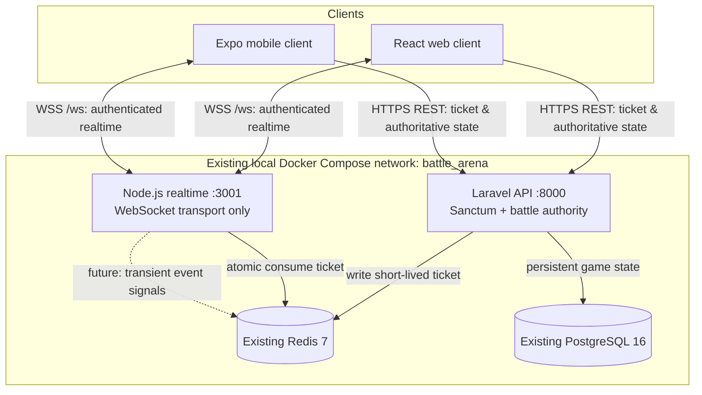
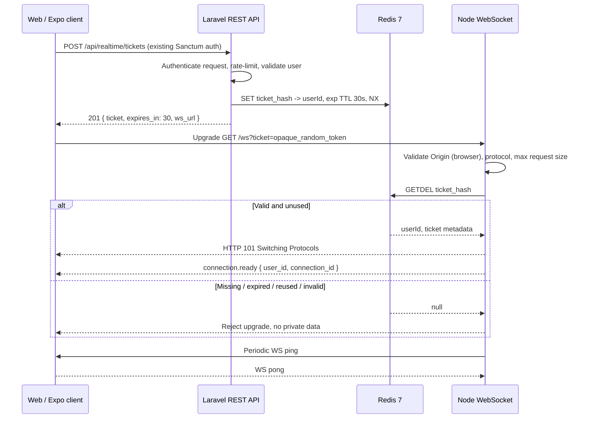

# Battle Arena — Phase 5A: Node.js Real-Time Gateway & WebSocket Infrastructure

**Status:** Proposed technical specification — Phase 5A only  
**Language:** English (implementation and technical documentation)  
**Target location:** `battle-arena-api/docs/PHASE5A_REALTIME_NODE_WEBSOCKET_SPEC_EN.md`  
**Scope:** Dockerized Node.js WebSocket gateway, secure authentication bootstrap, connectivity, operability and tests — **not playable PvP**  
**Game rule ownership:** Laravel remains authoritative.

> **Implementation principle:** The Node.js gateway is a transport, notification and presence boundary. It is not a second battle engine or a second authentication authority. An authenticated WebSocket connection is not, by itself, authorization to join any battle.

---

## 1. Executive decision

Start Phase 5 with a small, production-minded real-time foundation rather than immediately adding matchmaking, PvP combat, or a new game domain.

- Create a **new sibling application directory** `battle-arena-realtime/` containing a separate Node.js / TypeScript WebSocket service, its own package files, Dockerfile, tests and CI configuration. It is designed to become an independent fifth repository, but **do not create a remote GitHub repository, commit or push automatically**.
- Keep `battle-arena-infra/` as **Compose orchestration only**, referencing the sibling application with a build context. Do not move Node application source into infra or merge the existing repositories.
- Add a small, authenticated **short-lived one-use WebSocket ticket** endpoint in `battle-arena-api` to preserve current web Sanctum cookie sessions and mobile Sanctum bearer tokens.
- Use the **existing Redis 7 container** for atomic ticket consumption and readiness. No second Redis or database.
- Expose a local-only WebSocket port for development and add explicit, independently configurable LAN access for testing on a physical phone.
- Implement only `connection.ready`, protocol heartbeat, health, structured errors, graceful shutdown and reconnection guidance. **Do not implement battle room joins, PvP state, matchmaking, ranking or rewards in 5A.**

### Why a sibling application?

The current `battle-arena-infra/README.md` explicitly assigns infra **only** the role of local Compose orchestration for four independent repositories. A new long-running Node.js application merits its own dependency graph, tests, Dockerfile and lifecycle. The new folder does not alter or merge any existing repository.

### Existing baseline verified from current repositories

- `battle-arena-api`: Laravel 13, PHP 8.4, Sanctum, Postgres, Redis, configured PvE battle engine and XP rewards.
- `battle-arena-web`: React, Vite, TypeScript.
- `battle-arena-mobile`: Expo / React Native, with SecureStore-managed bearer credentials.
- `battle-arena-infra`: `compose.yaml` with `api`, `web`, `postgres`, `redis`, `mailpit` and optional RustFS (`minio` service), default host binds `127.0.0.1`.
- Current authorization strategy: web uses a first-party cookie session and mobile uses a personal access token; **never place either raw credential in a WebSocket URL**.
- Pre-existing CI issues at baseline: web lint failure in `MoveSelectionPanel.tsx` and mobile typecheck errors for i18next `t` props in `app/pve.tsx`. Treat these as existing failures and report separately; do not misrepresent them as caused or fixed by this phase.

---

## 2. Non-negotiable ownership boundaries

| Responsibility | Owning process | Notes |
| --- | --- | --- |
| Account authentication | Laravel | Sanctum cookies for web, bearer tokens for mobile |
| Creating one-use WS tickets | Laravel | Authenticated HTTP API route; short expiration |
| Consuming WS tickets | Node gateway + Redis | Atomic, one-time redemption |
| Managing live socket connections | Node gateway | Heartbeat, close, throttling, backpressure |
| Associating sockets with authenticated player ID | Node gateway | Derived from redeemed ticket, **not from client input** |
| Authorizing specific battle participation | Laravel | **Future Phase 5B**; must verify battle membership on every subscription/action |
| Battle engine, turn order, damage, HP, stamina, PP | Laravel | Reuse the existing authoritative engine |
| Persistent match state, battle events, XP | Laravel + PostgreSQL | No state authority in sockets or Redis |
| Cross-instance notifications | Redis | Future integration; transient Pub/Sub only as a hint |
| UI and sound playback | Web / Expo | Client uses authoritative API snapshots/events |

**Do not port the PvE engine to Node.** Do not implement duplicate level rules or invent PvP balancing.

---

## 3. Repository layout and local filesystem

Expected directory structure on the user's Windows machine:

```text
C:\FREELANCE\games\
├── battle-arena-api\
│   └── docs\
│       ├── BATTLE_ENGINE_PVE_SPEC_EN.md
│       └── PHASE5A_REALTIME_NODE_WEBSOCKET_SPEC_EN.md
├── battle-arena-web\
├── battle-arena-mobile\
├── battle-arena-infra\
│   ├── compose.yaml
│   ├── .env.example
│   └── README.md
└── battle-arena-realtime\            # NEW independent application directory
    ├── src\
    │   ├── app.ts
    │   ├── config\
    │   ├── http\
    │   ├── websocket\
    │   ├── auth\
    │   ├── redis\
    │   ├── protocol\
    │   └── observability\
    ├── tests\
    ├── Dockerfile
    ├── .dockerignore
    ├── .env.example
    ├── package.json
    ├── package-lock.json
    ├── tsconfig.json
    └── README.md
```

This is a suggested structure. Respect existing naming conventions and avoid empty layers or classes.

---

## 4. Architecture



### Node.js technology choice

- Use a **currently supported Node.js LTS** runtime in a pinned Docker base image; at specification time, Node.js **26.x is Active LTS**. Validate actual package compatibility before locking the version.
- **TypeScript**, strict mode, maintained Node HTTP server, and **`ws`** for RFC 6455 sockets. Use native browser `WebSocket` and Expo-supported WebSocket clients later.
- **`redis`** (node-redis) with a dedicated Redis client for authentication ticket redemption; reconnect behavior must fail closed for handshakes.
- Use a runtime schema validator (e.g., Zod) and structured JSON logs (e.g., Pino); keep dependency count small. Lock dependency versions in `package-lock.json`.
- Do **not** use Socket.IO for this native-WebSocket phase. Do not install Laravel Reverb: the project deliberately chooses Node.js for the WebSocket gateway.
- `ws` ping/pong is an application-level **transport heartbeat**. An HTTP `/health/*` endpoint is a different operational check.

---

## 5. Phase 5A scope and exclusions

| Deliverable | Phase 5A |
| --- | --- |
| New Node/TypeScript app with deterministic install and test scripts | **Build now** |
| Dockerfile, `.dockerignore`, non-root production runtime | **Build now** |
| Compose service, independent bind variable, healthcheck | **Build now** |
| Redis connectivity for one-use WS tickets | **Build now** |
| Authenticated Laravel ticket endpoint | **Build now** |
| Node ticket redemption + strict upgrade validation | **Build now** |
| `connection.ready`, ping/pong, close/reconnect behavior | **Build now** |
| Unit tests, integration tests, local smoke tests, README | **Build now** |
| Client WebSocket managers in React / Expo | **Not required** |
| Player presence list, friend status | **Future 5B** |
| Battle rooms and per-battle ACLs | **Future 5B** |
| Invites, private matches, matchmaking | **Future 5B/5C** |
| PvP engine workflows / turn relay | **Future 5B/5C** |
| Ranked ladders, seasons, tournaments | **Later phase** |

The gateway must not send protected account or battle data before ticket authentication succeeds.

---

## 6. Secure connection bootstrap

### 6.1 Why tickets?

Web browsers cannot attach arbitrary `Authorization` headers to native `new WebSocket()` handshakes, while the web app already uses Sanctum session cookies and the mobile app uses bearer tokens. Avoid passing existing session cookies, API bearer tokens, or persistent tokens in WebSocket query strings or localStorage. The API instead issues a single-use short-lived capability to establish **one** authenticated socket.

### 6.2 Proposed handshake



### 6.3 Ticket issuance: Laravel

Suggested new endpoint:

```http
POST /api/realtime/tickets
Authorization: Bearer <mobile-token>  # Mobile only
Cookie: ...                          # Existing web session; CSRF required
Accept: application/json
```

Response, illustrative only:

```json
{
  "data": {
    "ticket": "base64url-random-256-bit-secret",
    "expires_in": 30,
    "ws_url": "ws://localhost:3001/ws"
  }
}
```

Requirements:

1. `auth:sanctum` and an explicit rate limiter; preserve web CSRF and current mobile bearer auth.
2. Use cryptographically secure random bytes (at least 256 bits). Do not use `user_id`, email, a JWT without rotation, or predictable data as tickets.
3. Store **only a hash of the ticket** as the Redis key, with a TTL of approximately 30 seconds, and minimal JSON metadata (`user_id`, `issued_at`, optional session/token identifier as appropriate). Do not store the raw ticket.
4. Ensure Laravel and Node use the **same dedicated Redis key namespace** and serialization contract. Verify Redis client prefix behavior; do not accidentally double-prefix keys with Laravel cache prefixing.
5. Return `Cache-Control: no-store`, do not log the ticket, and avoid exposing the ticket via analytics or error telemetry.
6. Treat ticket issuance as a login-equivalent security-sensitive operation for throttle, abuse mitigation and audit purposes.
7. Validate user eligibility at ticket issuance. Ticket **does not** authorize battle membership.
8. Provide a safe, deliberate strategy for logout/token revocation and long-lived sockets in a later security milestone: maximum socket lifetime, periodic revalidation and/or explicit revocation. At minimum, set a conservative configurable maximum connection lifetime in 5A; disclose remaining revocation limitations.

### 6.4 Atomic redemption: Node

- Accept `GET /ws?ticket=...` only on the expected endpoint and protocol. Query ticket is a temporary, one-time credential only; use TLS/WSS outside isolated local development.
- **Never log full request URLs or ticket contents.** Sanitize upstream proxy and application access logs as well.
- Validate the `Origin` header against an explicit configured allowlist for browser traffic. A mobile/native client may omit Origin; that exception must still require a valid ticket and be documented. Treat Origin as a defense-in-depth signal, not authentication.
- Bound handshake time, request length and maximum concurrent unauthenticated upgrades. Validate upgrade headers; reject malformed or duplicate ticket parameters.
- Derive `SHA-256(ticket)` and atomically execute `GETDEL` on the ticket hash key (supported by Redis 7). Expired/used/wrong-format tokens are rejected.
- Make ticket **single-use across all Node instances** (Redis shared consumption).
- If Redis is unavailable: fail closed for new handshakes, do not fall back to anonymous sockets.
- Never accept `user_id`, `trainer_level`, `battle_id` or `is_admin` as client-trusted identity.
- Successful upgrade is a valid authenticated transport session only; private channels remain unavailable until authorization is designed in Phase 5B.

### 6.5 Important WebSocket security controls

- Prefer `wss://` in deployment, with a reverse proxy handling TLS and the `Upgrade` / `Connection` headers.
- Explicit origin allowlist; reject foreign origins on browser upgrades; do not use permissive wildcard CORS as a substitute.
- Max frame size (e.g., 8 KiB for the initial protocol), strict UTF-8 JSON schemas, bounded rate and connection counts.
- Disable permessage-deflate unless a measured need exists; avoid memory/CPU abuse.
- Handle idle clients via ping/pong, close dead connections, and apply send backpressure limits.
- Do not trust `X-Forwarded-For` except from a configured proxy and never treat it as user identity.
- Never expose raw stack traces or secrets to clients. Use generic error codes and structured logs.
- On SIGTERM/SIGINT stop accepting upgrades and close sockets gracefully; avoid endless hanging shutdowns.
- For production readiness, document logout/session revocation, cross-origin/cookie risks and reverse proxy timeouts.

---

## 7. Protocol v1 (Phase 5A)

The protocol is intentionally narrow. No battle actions are accepted over WebSocket in this phase.

### 7.1 Server-to-client event

```json
{
  "v": 1,
  "type": "connection.ready",
  "event_id": "generated-unique-id",
  "sent_at": "2026-11-25T19:00:00Z",
  "payload": {
    "connection_id": "generated-opaque-id",
    "player_id": 42,
    "heartbeat_interval_ms": 30000
  }
}
```

Identity is **server-derived**, not echoed from a client-provided value. Exposure of `player_id` to the same authenticated user is acceptable, but do not expose other players, emails or account details.

### 7.2 Client-to-server frames

Phase 5A can support either **no application client frames** (only protocol ping/pong) or a strictly limited `ping` / `pong` diagnostic schema if useful for testing. Prefer transport-level ping/pong; do not create fake gameplay commands.

### 7.3 Stable error envelope

Before successful upgrade, return HTTP 401/403/429/503 as appropriate (without leaking whether a user exists). After upgrade, send documented safe codes and close the connection with an appropriate WebSocket close code.

Example:

```json
{
  "v": 1,
  "type": "connection.error",
  "event_id": "generated-unique-id",
  "payload": {
    "code": "PROTOCOL_UNSUPPORTED"
  }
}
```

Document codes. No human English strings are required in transport payloads: all end-user UI messages must be localized in web/mobile (`en`, `fr`, `pt-BR`, `it`, `es`) when clients are integrated.

### 7.4 Future protocol **examples only — do not implement now**

```text
battle.invite.received
battle.room.joined
battle.opponent.ready
battle.turn.awaiting_action
battle.state.updated
battle.result.finalized
player.presence.changed
```

Future real-time notifications should contain an authoritative `battle_id`, persisted event `sequence` and version. The client must use REST to restore missed state; notifications are hints, not the source of truth.

---

## 8. Node gateway internal architecture

Suggested modules:

```text
battle-arena-realtime/
  src/
    config/env.ts               # strict env validation
    app.ts                      # bootstrap/shutdown
    http/server.ts              # live/ready HTTP + upgrade
    websocket/upgrade.ts        # checks and ticket redemption
    websocket/connections.ts    # client lifecycle and backpressure
    websocket/heartbeat.ts      # ping/pong timeouts
    websocket/protocol.ts       # v1 output schemas
    auth/ticketStore.ts         # consume SHA-256-derived Redis ticket key
    redis/client.ts             # dedicated Redis transport
    observability/logger.ts     # structured, redacted logs
  tests/
  Dockerfile
  .dockerignore
  .env.example
  package.json
  package-lock.json
  tsconfig.json
```

- Prefer dependency injection for time, ticket store and socket factory in tests.
- Keep the HTTP upgrade path readable and auditable; do not hide all logic inside a generic framework.
- Create a new dedicated Redis connection or reuse safely; do not share one Redis client for Pub/Sub and regular commands if the chosen library enters subscriber mode.
- Keep player-to-socket mapping in memory in this phase; later cross-instance fanout belongs in Redis and must handle multiple devices per account.
- Do not persist messages or account data in Node's filesystem.

---

## 9. Docker Compose integration

**Existing Compose baseline:** services `postgres`, `redis`, optional `minio`/`minio-init`, `mailpit`, `api`, `web`; network `battle_arena`, volumes for existing data. Preserve these unchanged except narrowly necessary additions.

### 9.1 Proposed Compose service

Illustrative snippet; inspect and reconcile with the actual `compose.yaml` before editing:

```yaml
services:
  realtime:
    build:
      context: ../battle-arena-realtime
      dockerfile: Dockerfile
    environment:
      NODE_ENV: development
      PORT: "3001"
      REDIS_URL: redis://redis:6379
      WS_TICKET_REDIS_PREFIX: battle-arena:ws-ticket:
      WS_ALLOWED_ORIGINS: http://localhost:3000,http://127.0.0.1:3000
      WS_HEARTBEAT_INTERVAL_MS: "30000"
      WS_MAX_PAYLOAD_BYTES: "8192"
      WS_TICKET_TTL_SECONDS: "30"
    ports:
      - "${REALTIME_BIND_ADDRESS:-127.0.0.1}:${REALTIME_PORT:-3001}:3001"
    depends_on:
      redis:
        condition: service_healthy
    healthcheck:
      test: ["CMD", "node", "dist/healthcheck.js"]
      interval: 10s
      timeout: 3s
      retries: 5
      start_period: 10s
    networks:
      - battle_arena
```

**Implementation detail:** The sample healthcheck command requires an actual compiled `dist/healthcheck.js`. Create it or use a supported Node one-liner that does not require curl/wget. Do not copy this snippet with a nonexistent healthcheck file. Separate build-time `NODE_ENV` from runtime dependency installation; use a multi-stage build with production dependencies and an explicit development strategy.

### 9.2 API service configuration

Add the **same** ticket prefix and TTL to Laravel's environment / application config. Set the browser-returned WebSocket URL based on an explicit `PUBLIC_WS_URL` env variable (e.g., `ws://localhost:3001/ws`) rather than a container-internal hostname. The API must not return `ws://realtime:3001/ws` to a browser or phone.

### 9.3 Add to `battle-arena-infra/.env.example`

```dotenv
# Realtime Gateway — default is local-only
REALTIME_BIND_ADDRESS=127.0.0.1
REALTIME_PORT=3001
PUBLIC_WS_URL=ws://localhost:3001/ws
WS_TICKET_TTL_SECONDS=30
```

Do not commit real secrets; avoid duplicating environment values across files where possible. Use per-environment variable naming consistently.

### 9.4 Local networking

| Service | Local host port | Binding |
| --- | --- | --- |
| Web | 3000 | 127.0.0.1 |
| Laravel | 8000 | 127.0.0.1 |
| Realtime Node | 3001 | 127.0.0.1 |
| Redis | 6379 | 127.0.0.1 |
| PostgreSQL | 5432 | 127.0.0.1 |

The realtime container talks to Redis at `redis:6379` on the private Compose network. For physical phone testing, expose only API **and** realtime on the trusted private LAN (`API_BIND_ADDRESS=0.0.0.0`, `REALTIME_BIND_ADDRESS=0.0.0.0`) and use the developer computer's LAN IP in the respective public endpoints. Keep Redis/Postgres/RustFS bound to loopback. Add an OS firewall rule restricted to the private LAN and revert exposure when done. Never use plain `ws://` or `http://` on the public Internet.

A physical phone cannot connect to `localhost:3001` on the developer computer; `localhost` would refer to the phone.

---

## 10. Operational HTTP endpoints

These are HTTP, not WebSocket messages:

| Endpoint | Purpose | Behavior |
| --- | --- | --- |
| `GET /health/live` | Liveness | Process and HTTP server running |
| `GET /health/ready` | Readiness | Redis connected and authentication ticket consumption operational |
| `GET /ws` without valid upgrade ticket | Protected WebSocket route | No anonymous upgrade |

Health endpoints must return safe minimal content; never show secrets, tokens, account data, Redis key contents or internal topology. If Redis is unavailable, readiness must fail (503) while liveness may still pass.

Add graceful shutdown and signal handling; log lifecycle events without credentials. Document Docker Compose commands and network tests.

---

## 11. Reliability and delivery semantics

### Phase 5A

- One-time ticket redemption uses **atomic Redis `GETDEL`**; a second connection attempt with the same ticket must fail, even from another process.
- Heartbeat: server sends WebSocket ping on a configurable interval and closes silent/dead connections after a documented timeout. A reconnection must obtain a **new** ticket via authenticated REST.
- Limit connections per user, per IP and per service; enforce maximum message size and send-buffer backpressure.
- A recovered process never assumes connected clients retained any message history.

### Later phases (design guidance, not code now)

- Redis Pub/Sub is **at-most-once**; missed messages are not replayed. Use it for invalidation/signaling only, not durable battle results. Source of truth: PostgreSQL and Laravel REST.
- Write battle actions/events to PostgreSQL first; only then publish notifications. Consider an outbox pattern if guaranteed notification delivery eventually becomes necessary.
- Reconnecting clients perform `GET /api/pvp/battles/{id}` or analogous authorized fetch to resynchronize to the latest persisted version, and may fetch events since a sequence number.
- Never let Node decide winner, award XP or manipulate HP/stamina/PP.

---

## 12. Testing matrix

### Node unit tests

- Environment validation rejects invalid/missing required configuration.
- Ticket token generation is not performed by Node; hashing and matching are correct.
- Nonexistent/expired/reused tickets rejected.
- Cross-instance atomic consumption simulated/tested with Redis.
- Invalid Origin rejected; valid browser origin accepted; missing Origin policy explicit for native devices.
- Upgrade rejects missing ticket, duplicate ticket params, malformed JSON, oversized frames and unsupported routes.
- `connection.ready` contains only server-derived identity and protocol version.
- Ping/pong timeout closes stale connections; live connection survives.
- Backpressure and message-size bounds are enforced.
- All log paths redact ticket/query strings and private account information.
- Shutdown closes server and existing connections with a deadline.

### Laravel feature tests

- An unauthenticated user cannot request a ticket.
- Authenticated web session receives a one-use ticket, respecting CSRF where applicable.
- Authenticated mobile bearer receives a one-use ticket.
- Ticket record is hashed, TTL bound and excludes raw token storage.
- Rate limiting works; no-store response is present.
- Redis failure rejects issuance safely.

### Docker / integration smoke tests

1. `docker compose config` passes.
2. `docker compose up --build -d realtime` builds successfully and does **not** reset any existing volumes.
3. `GET http://localhost:3001/health/live` returns 200.
4. `GET http://localhost:3001/health/ready` returns 200 with Redis healthy.
5. An unauthenticated WebSocket upgrade is rejected.
6. Get one ticket from Laravel as a logged-in test user; connect once to `/ws` and receive `connection.ready`.
7. Attempt to reuse the ticket; the second handshake is rejected.
8. Wait for ticket expiry; reject stale ticket.
9. Restart Node; API/PvE/Redis/Postgres remain healthy.
10. Temporarily stop Redis in a controlled test environment; readiness fails, new handshakes fail closed; restore Redis. **Never delete volumes.**
11. On a physical mobile device (optional), validate LAN URL / firewall restrictions, not only simulator or browser.

### CI

- Realtime package: lint, typecheck, unit tests and build.
- API: new ticket endpoint feature tests; unchanged PvE tests continue to pass.
- Infra: `docker compose config` plus a container smoke test where runner capacity allows.
- Do **not** claim full runtime mobile test coverage if no device/emulator was executed.

---

## 13. Acceptance criteria / definition of done

Phase 5A is complete only when:

1. `battle-arena-realtime/` is a runnable, independently organized Node.js TypeScript app.
2. Docker Compose starts its `realtime` service without impacting API/Web/Postgres/Redis.
3. Default host bind is `127.0.0.1`, with independent `REALTIME_BIND_ADDRESS`.
4. Redis-backed authentication tickets can be issued by the currently authenticated Laravel user.
5. The WebSocket ticket is cryptographically random, short-lived, single-use and is **never** logged.
6. The gateway rejects unauthenticated and foreign-origin browser connections.
7. An authenticated client can establish a WS connection and receives a valid `connection.ready` event.
8. Transport heartbeat, idle detection and graceful shutdown work.
9. Liveness/readiness endpoints reflect actual state.
10. Network failure, Redis failure and repeated/expired tickets are handled safely.
11. Tests and documentation are complete, with actual commands/results reported.
12. Existing PvE gameplay and current trainer XP rules remain unchanged.
13. No playable PvP functionality is claimed or shipped as part of 5A.

---

## 14. Implementation milestones

**M0 — Inspect and establish baseline.** Read `.cursor/rules`, infra Compose, API Sanctum session/bearer flow and current CI status. Identify existing configuration conventions and avoid duplicates.

**M1 — Gateway scaffold.** Create sibling `battle-arena-realtime`, TypeScript build/test/lint, Node LTS image, strict env schema and readme. Implement health/live, health/ready and shutdown.

**M2 — Compose infrastructure.** Add `realtime` build context, private network, per-port binding, dependencies, healthcheck and documented commands. Validate with `docker compose config` and `ps`.

**M3 — Secure auth bridge.** Add Laravel one-time ticket issuer and Redis key contract. Implement Node atomic redemption, origin validation, frame size bounds and protocol `connection.ready`. Verify with authenticated end-to-end test.

**M4 — Reliability.** Add heartbeat, timeouts, reconnection guidance, logging redaction, graceful shutdown and failing-Redis behavior.

**M5 — Verification and handoff.** Run targeted tests and Docker smoke checks. Document exact commands, gaps, security assumptions and a realistic Phase 5B plan. Do not silently expand scope.

---

## 15. Proposed Phase 5B (NOT PART OF THIS IMPLEMENTATION)

Later, after 5A is stable:

1. Design PvP battle model and explicit invitation/acceptance workflow.
2. Introduce authenticated battle-room subscription with Laravel-verified ownership of **both** players.
3. Record each player's decision via Laravel REST with idempotency and turn/version checks.
4. Publish versioned battle-state notifications from committed Laravel results to the Node relay.
5. Rehydrate clients from REST on reconnect, preserving persisted event order.
6. Add timeouts, disconnect grace periods, cancellation/forfeit policy and fair-play controls.
7. Reuse the existing PvE Battle Engine; no duplicate damage calculator.
8. Apply the existing PvP rule: trainer level **6+**, reward **+20 XP win** and **+10 XP loss** for approved completed matches. Do **not** decide forfeits/disconnect rewards without an explicit policy.
9. Add private rooms by invite first; matchmaking and ranking only after this is proven reliable.

---

## 16. Critical existing-game rules (do not change)

- Trainer starts level 1, 0 XP.
- Trainer XP for next level = `100 × current trainer level`.
- Trainer level 1–5: PvE permitted, PvP locked; PvP unlocks at trainer level 6.
- Stage-1 selection allowance caps at 10; Stage-2 acquisition unlocks at level 10 and increases arithmetically through trainer level 20.
- Existing config currently defines PvE combat **win +10 XP / loss +5 XP**, and PvP **win +20 XP / loss +10 XP**. Existing PvE abandon counts as loss with **0 XP**. The user's recent summary used ambiguous wording about losing PvE XP; **do not silently alter the current config** in the realtime phase.
- Do not invent creature-level XP or stage-3 unlock rules.

---

## 17. Security / documentation references

- WebSocket Security Cheat Sheet — OWASP: https://cheatsheetseries.owasp.org/cheatsheets/WebSocket_Security_Cheat_Sheet.html
- `ws` package documentation and ping/pong: https://github.com/websockets/ws
- Redis Pub/Sub at-most-once behavior: https://redis.io/docs/latest/develop/pubsub/
- Redis Streams (for future durable delivery if needed): https://redis.io/docs/latest/develop/data-types/streams/
- Node.js release lines: https://nodejs.org/en/about/previous-releases
- Existing source of truth: `battle-arena-infra/compose.yaml`, `.env.example`, `README.md`, `battle-arena-api/app/Application/Authentication/LoginService.php`, `battle-arena-api/config/game.php`, `battle-arena-api/docs/BATTLE_ENGINE_PVE_SPEC_EN.md`.

---

## 18. Final report format for Cursor

At completion, report (without claiming unexecuted checks):

1. Repository and file changes (API / Infra / new Realtime; clients should be unchanged).
2. Node runtime, package choice and why.
3. Compose configuration, bind addresses and healthcheck behavior.
4. Laravel ticket API, Redis key contract, TTL, issue and atomic redemption logic.
5. Authentication, Origin validation, logout limitations and other security controls.
6. Protocol contract and heartbeat/shutdown strategy.
7. All commands actually run and their actual results.
8. CI status and distinction between existing versus new failures.
9. Manual local smoke test instructions.
10. Deferred work for Phase 5B.

**Do not automatically commit, push, create remote GitHub repositories, destroy volumes, or change gameplay rules.**
