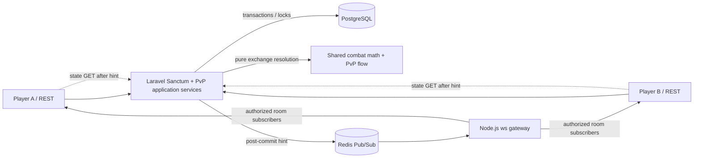

# Battle Arena — Phase 5B.2: Authoritative Two-Player PvP Battle Engine

**Status:** Implementation specification — not a statement of delivered features  
**Version:** 1.0 (Phase 5B.2 draft contract)  
**Date:** 2026-11-25 (America/Toronto)  
**Target repository:** `battle-arena-api`  
**Canonical path:** `docs/PHASE5B2_PVP_BATTLE_ENGINE_SPEC_EN.md`  
**Implementation boundary:** Backend-first, playable and fully testable via Laravel REST by two authenticated users. Minimal Node.js notification extension; no complete React/Expo battle arena in this phase.

> **Architecture invariant:** PostgreSQL/Laravel own players, room membership, creature selections, combat, resource spending, turn order, match outcome and XP. Node.js only delivers authorized state-change hints to already-authorized room subscribers. Redis is ephemeral. WebSocket events never serve as game commands or authoritative battle state.

## 0. Implementation instructions and baseline

1. Read this document in full, plus `docs/PHASE5B_PVP_PRIVATE_ROOMS_SPEC_EN.md`, `docs/PHASE5A_REALTIME_NODE_WEBSOCKET_SPEC_EN.md` (or the latest revision), and `docs/BATTLE_ENGINE_PVE_SPEC_EN.md`.
2. Inspect **local working trees**, `.cursor/rules/*.mdc`, latest migrations, controllers, service boundaries, OpenAPI resources and all tests in all five sibling projects. Do not rely solely on the remote default branch or overwrite uncommitted changes.
3. Reuse the *pure combat primitives* currently in `app/Domain/Battle/`: `DamageCalculator`, `ResourceCalculator`, `EffectiveStatCalculator`, `BattleRules`, `MoveSnapshot`, `CombatantSnapshot`, `TypeEffectivenessChart`, `SeededRandomSource`, and event/value structures wherever sensible. Carefully inspect `BattleEngine`, `BattleState`, `BattlePhase`, and `OpponentIntent` before changing them: they are currently **PvE-specific**. Do not directly reuse PvE controllers, persistence models, AI, or perspective-dependent state machine for PvP.
4. Add a PvP-specific, two-human state machine/orchestrator, with a genuinely shared pure resolution primitive if extraction is necessary. Any necessary shared-domain refactor must preserve all PvE public behavior and tests. Do not copy/paste the entire PvE engine into a second divergent engine.
5. Follow existing Laravel Sanctum session/bearer authentication, error-envelope conventions, Swagger/OpenAPI structure, versioning, and existing private lobby/invitation contracts.
6. Additive migrations only. Never reset databases, remove named volumes, regenerate `APP_KEY`, or commit/push automatically.
7. Keep `game.features.pvp = false` until the full PvP release gate in 5B.4; the backend endpoints can be exercised in automated tests or a **non-production explicit development flag**, not publicly released by accident.
8. All **new developer-facing docs, code comments and Cursor rules** should be English. Preserve existing end-user translations in `en`, `fr`, `pt-BR`, `it`, `es`. Do not put localized strings in persisted combat events.
9. This is a specification with proposed contracts. Adapt filenames/endpoints to existing conventions when justified; record deviations in the implementation report and in the document. Do not change established product rules without explicit confirmation.

### Baseline inspected for this specification

As of the reviewed code after the Phase 5B.1 handoff:

- `battle-arena-api`: `app/Application/Pvp/PvpLobbyService.php`, `PvpRealtimePublisher.php`, `config/pvp.php`, `app/Domain/Pvp/Models/PvpRoom.php` and `PvpRoomMember.php`, plus REST invitations/room/grants. Room states are currently `waiting_for_guest`, `ready`, `closed`; room memberships use `left_at`.
- Existing PvE: `BattleEngine::resolveAttackExchange` uses a pure exchange, but **the `Opponent` branch requires an already committed AI-style intent** and the next phases assume alternating player/AI turns. `BattleState` is expressly PvE-specific. Do not blindly use its outcome field to represent both users.
- Current rewards: `config/game.php` defines `battle.pvp_min_trainer_level = 6`, `battle.rewards.pvp.win = 20`, `battle.rewards.pvp.loss = 10`. These are **combat-finish** rewards, not lobby rewards.
- `battle-arena-realtime-websocket`: protocol v1; `connection.ready`, room subscription via one-use grants, `pvp.room.changed` and personal notifications, Redis Pub/Sub relay. The current `NotificationEnvelopeSchema` supports a generic typed notification envelope and `target_room_id`.
- React and Expo already have 5B.1 lobby UI. No PvP combat UI exists yet. Preserve these flows.

**Verification note:** These are source-observed design facts, not proof this phase is implemented or that the test suite is currently passing. Cursor must rerun tests locally.

## 1. Deliverables and exclusions

### Phase 5B.2 must deliver

- Secure selection of **one owned creature per human participant** in an accepted `ready` room; optional replacement before locking, no substitution after locking.
- Both users explicitly confirm readiness. When the second readiness is committed, start **exactly one** PvP battle in the same database transaction (or an equally atomic, deterministic transition).
- Durable two-player match, combatants, moves/PP, stamina, HP, attack commitments, defense resolutions, deterministic random cursor, versioned event log and results.
- Authenticated REST endpoints for: creature selection, readiness, current match state, attack, defense, and battle events.
- Human-vs-human **attack → opponent defense → resolve exchange → roles switch** until one combatant faints.
- Server-authoritative PP/stamina gating and recover-skip/basic-strike semantics consistent with PvE.
- Combat win **+20 trainer XP to winner**, combat loss **+10 trainer XP to loser**, granted **once per participant per match**, only from committed server-derived results. No XP for lobby close/leave, room invite decline/cancel/expire, duplicate command, or incomplete match.
- Post-commit, room-scoped `pvp.battle.changed` hints via the existing Redis/Node relay; persisted events and REST remain truth.
- Complete backend feature/unit/integration/security/concurrency tests, OpenAPI updates, and Cursor rules updates where relevant.
- Smoke-test protocol with **two distinct authenticated accounts**, ideally including Laravel REST + Node relay; no need for polished battle UI yet.

### Do not implement in 5B.2

- Public matchmaking, ranked ladder, seasons, teams, spectators, chat, economy, trading.
- A second WebSocket server, Redis instance, DB, or Socket.IO/Reverb.
- Game commands over WebSockets.
- Full React/Expo battle screen, animation, sounds, rich real-time UX (5B.3).
- User-visible disconnect-forfeit timers, AFK penalties, auto-awarding loss, matchmaking queue or timeout adjudication (5B.4). Until then an interrupted active battle is **paused/persisted**, not automatically treated as a loss.

## 2. Architecture



**Layer ownership:**

| Layer | Owns | Must not own |
| --- | --- | --- |
| Laravel domain/application | Active actor, move validation, RNG, turn transitions, HP/PP/stamina, outcome, rewards | Socket lifecycle |
| PostgreSQL | Authoritative room/battle/participant/action/event records | Ephemeral ticket secrets |
| Node gateway | Connection identity, room subscriptions, targeted hint delivery | Damage, XP, match decisions, PostgreSQL membership queries |
| Redis | One-use WS tickets/grants, pub/sub notification stream | Persistent battle state |
| Web/Expo | Sending decisions over authenticated REST; rendering authorized state | Changing HP/XP or inferring winners |

## 3. Product rules (confirmed and proposed)

### Confirmed by existing game configuration

- Minimum trainer level: **6** for both participants. Check at ready/start, not only when invite was accepted.
- Existing PvP reward policy: **combat winner +20 XP**, **combat loser +10 XP**; source is server-persisted outcome. Do not replace with points from the client.
- One creature versus one creature per match. Trainer level, owned-creature level and creature evolution stage remain different concepts.
- Battle resources: HP, stamina and per-move PP. Reuse existing versioned combat rule snapshot; changes mid-battle must not mutate an active match's rule set.
- Defense choices: `endure`, `block`, `dodge`, `recover`, using existing configurable costs/effects. Attack-side `recover` skips the attack only when PP remains but no move is affordable. `basic_strike` only after all equipped move PP is depleted, preserving existing logic.

### Selected MVP design decisions for 5B.2 (new, adjustable)

- Either participant may pick an **owned, eligible** creature while the room is `ready`; pressing Ready locks that selection. Both selections must be locked to start.
- A **server-side unbiased random draw**, stored/seeded for audit/replay, decides the first attacker. The host does not always attack first.
- After a committed attack, **the defender sees the selected move** (name/metadata required to choose a reaction); the defender does not see the attacker's unselected move list or future RNG. Damage/PP/stamina exchange is resolved only when defense is submitted. A committed attack cannot be changed or cancelled.
- The first attacker selects a move or eligible recover-skip. When recover-skip happens, attacker recovers 15 stamina (or snapshotted rule amount), skips damage, and roles switch immediately. Otherwise the opposite human chooses defense, then a pure exchange resolves and roles switch if both survive.
- No neutral/client-determined draw outcome in this phase. Finish on KO only. If both could theoretically reach zero with future mechanics, define and test deterministic resolution before exposing such mechanics.
- **No disconnect/leave auto-loss in 5B.2.** Active match remains retrievable; block the legacy lobby `leave` action from quietly closing/forfeiting an active match. Define 5B.4 user-visible forfeit/timeout separately.
- One active PvP battle per user, one battle per room. Any additional PvE/PvP overlap policy must be explicit and tested rather than implicit.
- Only authorized room participants may view an active battle. After the room closes, both **recorded battle participants** must retain read-only access to their own final battle and events even if `pvp_room_members.left_at` is set; everyone else receives existing non-enumerating authorization responses.

## 4. State machines and transitions

### Room lifecycle extension

Current: `waiting_for_guest -> ready -> closed`. Add an internal `in_battle` transition; use `closed` with `closed_reason = battle_completed` **only after combat and rewards are committed**, preserving room and match history. If a distinct `completed` state better matches local conventions, document the choice and update all membership/active-room queries accordingly.

```mermaid
stateDiagram-v2
  [*] --> waiting_for_guest
  waiting_for_guest --> ready: Invite accepted
  ready --> in_battle: Both participants locked/ready; battle created
  ready --> closed: Cancel/leave before combat; no XP
  in_battle --> closed: Combat finished and rewards committed
  note right of in_battle
    Do not allow 5B.1 leave to discard live combat.
    Disconnection does not imply defeat in 5B.2.
  end note
```



### PvP battle lifecycle

```mermaid
stateDiagram-v2
  [*] --> awaiting_attack: Server chooses starting attacker
  awaiting_attack --> awaiting_defense: Current attacker commits valid move
  awaiting_attack --> awaiting_attack: Eligible recover-skip switches attacker
  awaiting_defense --> awaiting_attack: Defender reacts; both survive; switch attacker
  awaiting_defense --> finished: Defender reacts; KO resolved
  finished --> [*]
```



**Important:** The two `awaiting_attack` states before/after recover-skip are distinct versions and actors. Never allow a no-op recovery loop on the same actor. A new version is committed and the opponent becomes attacker.

### Sequence: move commitment and defense

```mermaid
sequenceDiagram
  participant A as Player A
  participant L as Laravel API
  participant DB as PostgreSQL
  participant R as Redis / Node relay
  participant B as Player B
  A->>L: POST /pvp/battles/{id}/attack (move + expected_version + idempotency)
  L->>DB: Lock battle + validate A is current attacker
  L->>DB: Persist immutable attack commitment; version++
  L-->>A: 200 authoritative state
  L-->>R: After-commit pvp.battle.changed (room_id, battle_id, version)
  R-->>B: Hint (authorized subscriber only)
  B->>L: GET /pvp/battles/{id}
  L-->>B: Sanitized pending move and allowed defense choices
  B->>L: POST /pvp/battles/{id}/defend (defense + expected_version + idempotency)
  L->>DB: Lock + resolve pure combat exchange + persist events / rewards
  L-->>B: 200 authoritative state
  L-->>R: After-commit pvp.battle.changed
  R-->>A: Hint
  A->>L: GET /pvp/battles/{id}
```

### State invariants

- `awaiting_attack`: exactly one `current_attacker_user_id`; other is defender; `pending_attack = null`.
- `awaiting_defense`: exactly one immutable pending attacker move and the opposite `current_defender_user_id`; cannot attack again until resolution.
- `finished`: result, winner/loser and `finished_at` consistent; no further attacks, defenses, selection or ready mutations.
- `round` and `version` monotonic; `event_sequence` monotonic and gap-free per match **as committed**. Define round as one exchange or one pair of exchanges, then keep both documentation and tests consistent (recommended: each resolved attack/defense exchange increments `turn_number`; `round` may be defined as two turns).
- State/version progression is independent of whether WebSocket message delivery succeeds.

## 5. Persistence model (additive PostgreSQL migrations)

Inspect existing `pvp_rooms`, `pvp_room_members`, `pvp_request_replays` and PvE tables before naming new columns. **Do not reuse the `pve_battles` table as a fake PvP match.** Prefer separate PvP aggregate/tables with shared domain primitives.

### Extend `pvp_rooms`

- Status `in_battle`, final reason `battle_completed` (or equivalent documented transition).
- Link to its match by unique `room_id` on `pvp_battles` (not necessarily a column on room).
- Update `PvpRoom::isOpen`, `assertNoOpenLobby`, room subscription-grant policies and leave/cancel policy to explicitly handle `in_battle`.
- Preserve all existing invitation and room semantics. Current ready-room membership continues to be authorized during battle.

### `pvp_battle_selections` (or equivalent)

- `(room_id, user_id)` unique; FK room and user, FK to **owned** creature.
- `owned_creature_id`, `selected_at`, `is_locked`, `locked_at`, optional `version`.
- At selection/ready time require owned creature belongs to authenticated user and is eligible; forbid swapping after lock. Validate ownership again within the start transaction. Selections may be updated before locking.

### `pvp_battles`

- `id` UUID/ULID primary key; `room_id` FK **unique**; `status` active/finished, `phase` awaiting_attack/awaiting_defense/finished; version; turn/round; `current_attacker_user_id`, `current_defender_user_id`; `pending_attack_snapshot` (opaque validated server-built snapshot), `rng_seed` and `rng_cursor` (secret), `rules_version`, `rules_snapshot`, `reward_snapshot`; `winner_user_id`, `loser_user_id`, `end_reason` (`combat` for this phase), `started_at`, `finished_at`.
- Index on room/status/user turn data; prevent invalid self-match and duplicate room battle with application checks + database uniqueness.
- A user must be able to retrieve current match by authorized room or direct battle ID, without exposing other rooms.

### `pvp_battle_combatants` and `pvp_battle_combatant_moves`

- Two immutable **participant identity** snapshots (`user_id`, `owned_creature_id`, `side`/slot, name/slug/level/base/effective stats/types/image/cry URLs as needed), with mutable current HP/stamina and per-move PP stored in match-scoped tables.
- Maintain **exactly two distinct** user IDs. Avoid changing the player's actual owned creature data based on battle resource consumption unless a separate game rule explicitly requires it.
- Store each combatant's move loadout and PP max/current. Do not reveal opponent's unselected move list in REST serializers.

### `pvp_battle_actions`, `pvp_battle_events`, `pvp_battle_rewards`

- Actions persist immutable actor/user, type, request fingerprint, idempotency key, expected/resolved version, result snapshot and timestamps. Unique idempotency scope `(battle_id, actor_user_id, idempotency_key)`; reject same key with changed payload.
- Events have `(battle_id, sequence)` uniqueness and structured typed payloads. Distinguish `attack_committed`, `attack_skipped`, `defense_selected`, `damage_applied`, `stamina_changed`, `pp_changed`, `fainted`, `battle_finished`, `reward_awarded`, as appropriate; serialize event names independent of locale.
- Rewards: `(battle_id, user_id)` unique with explicit amount, outcome, and progression/XP event linkage. If reusing existing progression idempotency store, ensure exactly-once is enforced at the source; a new dedicated reward table is optional if the existing durable event makes the guarantee unambiguous.
- Redact or omit hidden RNG seed, raw server internal state and opponent's private move loadout from API responses and logs.

### Storage safety

- Use foreign keys/constraints, composite unique keys, indexes, transactional row locks, and a **consistent lock order** across ready/start/attack/defend/finish operations.
- Add migrations only. On empty databases, seed data through existing commands; never run a destructive reset on existing user data.
- Decide how expired/revoked accounts and a deleted creature are handled; snapshots must permit an existing match to finish deterministically without refetching live catalog data.

## 6. REST contract (proposed names; align with existing conventions)

All endpoints are under `auth:sanctum`. Mutations require `Idempotency-Key` (or an equally safe established convention), expected-version validation when stateful, rate limits, FormRequests, thin controllers, application services and existing localized machine-readable error envelopes.

| Method | Route | Auth | Purpose |
| --- | --- | --- | --- |
| `PUT` | `/api/pvp/rooms/{room}/selection` | participant | Choose/change one owned creature while room is ready and player not locked |
| `POST` | `/api/pvp/rooms/{room}/ready` | participant | Lock selection; if both locked create exactly one PvP battle |
| `GET` | `/api/pvp/rooms/{room}` | participant | Existing lobby response extended with sanitized selections/ready/battle pointer |
| `GET` | `/api/pvp/battles/{battle}` | participant | Snapshot, actor/phase, own moves, opponent public stats, allowed actions |
| `GET` | `/api/pvp/battles/{battle}/events?after_sequence=N` | participant | Ordered, paginated combat events for reconstruction |
| `POST` | `/api/pvp/battles/{battle}/attack` | current attacker | Commit one move or valid recover-skip |
| `POST` | `/api/pvp/battles/{battle}/defend` | current defender | Resolve committed move + defensive reaction |

Only room participants are authorized. Avoid leaking existence to nonmembers through response codes, timing, or verbose error detail. Controllers must derive actor from Sanctum, never `player_id` from body.

### Example: selection

```http
PUT /api/pvp/rooms/ROOM_UUID/selection
Idempotency-Key: unique-client-action-id
Content-Type: application/json

{"owned_creature_id": 123, "expected_room_version": 4}
```

Proposed response: `{ "data": { "room": { "id": "...", "status": "ready", "version": 5, "my_selection": { "owned_creature_id": 123, "locked": false }, "players": [...] } }`. Never expose the other player's unconfirmed private selection if that is not explicitly allowed by a product rule. Define when public creature selection is revealed; recommended: reveal both once both locked.

### Example: ready/start

```http
POST /api/pvp/rooms/ROOM_UUID/ready
Idempotency-Key: unique-client-action-id
Content-Type: application/json

{"expected_room_version": 5}
```

Response includes latest lobby state and, if both locked, a `battle_id` and battle summary. If two `ready` requests race, **at most one** match starts; both users can fetch it. Start must snapshot rules/rewards, creatures and starting turn exactly once.

### Example: attack commitment

```http
POST /api/pvp/battles/BATTLE_UUID/attack
Idempotency-Key: unique-client-action-id
Content-Type: application/json

{"move_id": 55, "expected_version": 3}
```

Equivalent valid exclusive actions: `{ "recover": true, "expected_version": 3 }` and `{ "basic_strike": true, "expected_version": 3 }` (only when allowed by server snapshot). Exactly one mode per request. The attacker cannot supply defense, HP, damage, opponent identity, winner or XP.

- Validate actor is current attacker, phase correct, creature alive, PP and stamina sufficient, move equipped.
- Persist committed move and version once; defender can now fetch declared attack. No attack damage is resolved until defense.
- Recover-skip immediately restores snapshotted stamina amount, switches attacker, increments version and events; it **does not** charge PP or create pending defender action.
- If all equipped moves have zero PP, allow `basic_strike`; if PP exists but stamina is insufficient for every move, allow only recover-skip.

### Example: defense

```http
POST /api/pvp/battles/BATTLE_UUID/defend
Idempotency-Key: unique-client-action-id
Content-Type: application/json

{"defense":"block", "expected_version":4}
```

- Validate actor is defender and defense affordability; read the exact already-committed attack; do not let either participant change it.
- Invoke **pure deterministic** shared exchange calculation with snapshotted rule/version/seed/cursor and the correct attacker/defender combatants.
- Spend resources exactly once **at resolution** (not once on commitment and again at defense). If attack phase chooses to reserve costs early, that design requires equivalence proofs, compensations and comprehensive tests; prefer resolution-only spending for MVP.
- Persist updated combatants, moves, RNG cursor, events, version and next actor atomically.
- A KO sets winner/loser and triggers exactly-once per-user reward from the committed battle result. On finish, close room consistently and notify both members. No double-grant on GET/retries.

### Example sanitized battle state

```json
{
  "data": {
    "id": "BATTLE_UUID",
    "room_id": "ROOM_UUID",
    "mode": "pvp",
    "phase": "awaiting_defense",
    "status": "active",
    "version": 4,
    "turn_number": 1,
    "rules_version": "pve-0.1",
    "current_attacker_user_id": 101,
    "current_defender_user_id": 202,
    "pending_attack": {"move_name": "Ember", "move_slug": "ember"},
    "me": {"user_id": 202, "hp": {"current": 25, "max": 25}, "stamina": {"current": 100, "max": 100}, "moves": []},
    "opponent": {"user_id": 101, "hp": {"current": 25, "max": 25}, "stamina": {"current": 100, "max": 100}},
    "allowed_actions": ["defend"],
    "last_event_sequence": 12,
    "outcome": null
  }
}
```

Values and rules version are placeholders, not actual game data. `me/opponent` are **viewer-relative** and must never drive persistence identity or event ownership. More generally return only information permitted for that actor.

### Error contract and recovery

Use existing API error-envelope conventions with stable codes, user-facing translations for later clients and appropriate HTTP status:

- 401 unauthenticated; 403/404 nonmember, not eligible, or non-enumerating private resource.
- 409 `PVP_WRONG_TURN`, `PVP_PHASE_CONFLICT`, `PVP_VERSION_CONFLICT`, `PVP_ALREADY_FINISHED`, `PVP_ROOM_NOT_READY`, `PVP_SELECTION_LOCKED`, `PVP_ALREADY_IN_BATTLE`, `PVP_IDEMPOTENCY_CONFLICT` (exact names may adapt to established API error enum).
- 422 invalid/missing move or creature selection; 429 rate limits.
- 503 transient storage failure; do not return false success.
- On `409` client fetches fresh REST state and reapplies UX; on retry with same idempotency key and identical payload return the original committed result without duplicate effects.

## 7. Reuse plan for existing pure Battle Engine

The current `BattleState`, `BattlePhase` and `OpponentIntent` are not neutral: they encode **one player vs. AI**. The `BattleEngine::exchange()` pure implementation already includes damage, accuracy, dodge, stamina and PP; the wrapper phase logic alternates AI/player assumptions. To avoid PvE regressions:

1. Extract or expose a **neutral pure combat-exchange calculator** accepting immutable `attacker`, `defender`, `MoveSnapshot`, defense type, `BattleRules`, `TypeEffectivenessChart`, injected RNG and event sequence; produce next two snapshots, sequenced events, RNG cursor and faint/KO result without knowing whether the attacker is a human or AI.
2. Keep existing `BattleEngine` public PvE methods and their behavior unchanged, delegating to the shared calculation where possible. All current PvE tests must continue to pass unmodified except justified fixture updates.
3. Implement a distinct `PvpTurnEngine`/orchestrator that controls **who is attacker**, commitment/defense phases, turn switching, snapshots, winner user IDs and room lifecycle, composed with the neutral calculator.
4. Do not duplicate the damage formula in Node/JS. Do not rely on player-relative `win/loss` stored in the shared `BattleState` to decide two-user results. Translate from a durable `winner_user_id`/`loser_user_id` only in the PvP application layer.
5. Reuse `CombatantFactory` or extract mode-neutral snapshot factory (currently constructor depends on `PveRulesProvider`); do not let PvP accidentally depend on AI opponent selection.
6. Preserve RNG draw order and rounding; ensure seed/cursor progression can be replayed deterministically. Do not return secret RNG seeds in public API.
7. Add parity/compatibility tests comparing known PvE exchange fixtures before and after extraction and symmetric PvP exchanges for both host/guest.

**Fallback if extraction is too risky:** Implement a narrow shared-domain adapter around existing value objects, with explicit tests, and describe why. Never fork a second independent damage formula.

## 8. Transaction, concurrency and idempotency rules

### Locking

- Start transaction: lock `pvp_rooms` and both selection records (consistent order), verify two active memberships, level requirements, ownership and both ready; insert `pvp_battles` with unique `room_id`; change room to `in_battle`; commit and publish hints afterwards.
- Attack/defend transaction: lock `pvp_battles` first, then ordered combatants/moves/actions and (on finish) corresponding room/reward records; validate actor and expected version inside lock; no stale-client mutations.
- Document one lock ordering contract for **all** operations, including lobby leave/start/finish to avoid deadlocks. Prefer room-before-battle where every cross-aggregate operation uses both; whichever choice is selected must be consistent everywhere. For battle action, lock order must follow that contract (e.g. find room ID, lock room, then match). Include concurrent PostgreSQL tests.
- Replay/idempotency under concurrency must rely on database uniqueness + transactional checks, not an in-memory Map or optimistic client-side state.

### Exactly-once combat rewards

- Finish is authoritative only after committed KO result. **Both** winner and loser rewards are processed in the same transactional consistency boundary (or with a durable outbox/recovery mechanism that cannot mark finished while losing one reward).
- Use `BattleRewardPolicy::MODE_PVP`, configured `win=20`, `loss=10`. Existing `BattleRewardService` accepts `verified` as an argument; calling it with `verified=true` from an arbitrary request body would be unsafe. Introduce a private server-derived completion pathway from a persisted, validated PvP result or equivalent.
- Deterministic progression idempotency key per **battle/user**, e.g. `battle:pvp:{battle_id}:{user_id}`. Never award twice on retry, reconnect, GET or an expired request.
- No XP/record changes for lobby decline, cancellation, expiration or leave-before-combat; no XP for paused/incomplete matches. Explicit forfeit/timeout rewards postponed to 5B.4.

### WebSocket hints

- Emit after-commit **only**. A reconnecting client that misses any hint must recover from `GET /api/pvp/battles/{battle}`.
- Never publish move lists, raw attack secrets, full state, HP mutations, damage decisions or credentials through Redis notifications. Only opaque battle/room IDs and committed monotonic version/event sequence.
- `PvpRealtimePublisher` currently uses best-effort Redis Pub/Sub. Treat missed deliveries as acceptable only because REST is authoritative, and refresh on focus, reconnect and REST mutation. Preserve failure isolation.
- On completion, deliver `pvp.battle.changed` before any room subscription revocation; if room close revokes immediately, also send **targeted user notifications** or ensure reconnect access to final result. Neither delivery ordering nor transient Redis failures may affect committed rewards/state.

## 9. Node.js v1 notification contract

Reuse existing connection tickets, room grants, room subscriptions and notification envelope. No PvP game action is accepted over WebSockets.

### Redis publication (Laravel → Node)

```json
{
  "v": 1,
  "type": "pvp.battle.changed",
  "event_id": "opaque-event-uuid",
  "sent_at": "2026-11-25T23:00:00Z",
  "target_room_id": "ROOM_UUID",
  "payload": {
    "room_id": "ROOM_UUID",
    "battle_id": "BATTLE_UUID",
    "version": 5,
    "last_event_sequence": 17
  }
}
```

The Node gateway must accept only a **trusted Redis publisher path** and the established `NotificationEnvelopeSchema` / allowlists, then send a schema-validated WebSocket frame to **authorized subscribers only**. Do not deliver on arbitrary `room_id` supplied by a client; no new subscription grants are needed for existing authorized room subscriptions. If room/membership changes, use existing revoke and fail-closed behavior.

### Browser/Expo handling (implemented in 5B.3)

- Deduplicate by `event_id`.
- If `version > local.version`, fetch state via REST; never apply delta as truth.
- If events are missed/out of order, fetch `/events?after_sequence=N`; if sequence gap is detected, do full REST rehydrate.
- Room membership and player perspective must be verified by Laravel after reconnect. Never infer access from a stale socket.

## 10. Security requirements

- `auth:sanctum` session+CSRF for web and bearer for Expo; never put long-lived bearer in WS query strings.
- Authorization based on authenticated user, active `PvpRoomMember`, and that player's combatant; never accept client-supplied `attacker_user_id` or `defender_user_id`.
- New grants use 5B.1 secure one-time model; connection ticket grants identity only. Preserve origin validation, ticket hashing, one-time consumption and rate limits.
- No player can select another user's owned creature, attack out of turn, resolve their own committed attack as the defender, select another person's defense, see a private room, or alter battle state by replay.
- Never log JWT/Sanctum credentials, Redis tickets/grants, raw socket URLs with tickets, RNG seed or unsanitized private model snapshots.
- Validate all input and output schemas. Bound request sizes, event pagination, frame payloads and per-user request rates.
- Protect against race conditions with DB row locks, uniqueness constraints, idempotency and expected versions; cross-user authorization tests are mandatory.
- No unauthorized matchmaking, spectating or global player search.

## 11. Test plan (must automate)

### Pure domain unit tests

1. Damage accuracy/type/STAB/rounding, dodge/block/endure/recover parity with PvE fixtures.
2. Player A attack → B defense; B attack → A defense; attacker identity and resource spending correct on both turns.
3. Attack commitment immutable; no damage/PP/stamina spent before resolved defense (unless explicitly reserved by documented alternate design).
4. PP exhaustion → basic strike; PP remaining but insufficient stamina → recover-skip and actor switches; invalid recovery/basic strike rejected.
5. Seeded RNG determinism with same snapshots and cursor; replay yields same result/events.
6. KO result maps to winner/loser user IDs, independent of host/guest or player/opponent side.
7. Invalid move, unaffordable defense, stale version rejected without partial persistence.

### Laravel feature/integration tests (real PostgreSQL for concurrency tests)

1. Two distinct trainer accounts >=6 accept invite and select **their own** creatures.
2. Attempts from level <6, unrelated users, unowned creature, same user in two slots, changing selection after lock, expired/closed room fail.
3. Both ready → exactly one PvP battle even on simultaneous requests/retries; room state goes to `in_battle`.
4. Roles and allowed actions are accurate from each participant's GET view; opponent move list and RNG remain hidden.
5. Attack-only phase doesn't decrease HP; defender resolution does, exactly once; event/turn sequence is stable.
6. Simultaneous same-side requests and out-of-turn requests yield one committed action; version conflict for stale commands.
7. Same idempotency key/same payload returns recorded result; same key/different payload conflicts; no duplicate PP, stamina, events, win or XP.
8. Finish via real KO grants +20/+10 exactly once and persists both rewards and combat outcome; no client-controlled `verified` bypass.
9. Empty/full Redis or Node outage does **not** block authorized REST combat; missed hint never changes battle state.
10. 5B.1 leave/cancel cannot close an `in_battle` room or award fake result; invitation/lobby regression tests pass.
11. All previous PvE engine, reward, resource and combat log tests pass unchanged.
12. GET events pagination/authorization; 404/403 nonmember state non-enumeration; no secret or hidden data leakage.
13. Redis Pub/Sub hint emitted after committed state; no notification for rolled-back transactions.
14. Both users can resume by GET with no WebSocket connection.

### Node integration tests

- Authorized room subscriber A and B receive `pvp.battle.changed` with same correct version after trusted Redis publication.
- Unsubscribed third party receives nothing; forged client `room_id` is insufficient for access; legacy `connection.ready` still works.
- Duplicate/out-of-order notification hints cannot grant game authority; payload malformed or unauthenticated publish path fails safely.
- Existing 5A ticket and 5B.1 subscription/ACL tests remain green.

### CI / smoke commands

Use actual scripts discovered in each repository; examples:

```bash
cd battle-arena-infra
docker compose up --build -d
# Non-destructive migrations only:
docker compose exec api php artisan migrate
docker compose exec api php artisan test
# Node standalone:
cd ../battle-arena-realtime
npm ci && npm run lint && npm run typecheck && npm test && npm run build
```

Also document a repeatable two-user REST happy-path smoke sequence (tokens, invitations, creature selection, ready/start, attack/defend, final XP) with **no real credentials committed**. Use CI PostgreSQL for lock/concurrency tests rather than claiming SQLite simulates concurrent locks.

## 12. Milestones — implementation order

| Milestone | Deliverable | Verification |
| --- | --- | --- |
| **P0** | Read specs/code; review baseline, local changes and rules; produce brief architecture map | No code clobbered; clear design for neutral calculator |
| **P1** | Extract mode-neutral pure combat exchange; add parity tests; define PvP phases | PvE regression and pure PvP unit tests green |
| **P2** | Additive selection/battle/action/event/reward schema and Eloquent models | Migrations safe, constraints/indexes verified |
| **P3** | Authenticated ready/start and battle REST attack/defend/state/events; robust transactions | Two-player REST integration, idempotency and concurrency tests |
| **P4** | Exactly-once winner/loser XP and result finalization; room transition | XP 20/10 once; no lobby XP |
| **P5** | Publish after-commit hints; Node schema/relay; docs, security tests, CI and smoke | Authorized fanout, no payload leakage, old tests green |

Do not stop after a plan. Deliver Phase 5B.2 and validate what you can in the current environment. **Do not silently proceed to 5B.3**.

## 13. Definition of Done

- [ ] Two distinct authenticated level-6+ users can join a ready room, select an owned creature and lock readiness.
- [ ] One and only one match starts, regardless of concurrent duplicate readiness.
- [ ] Turn sequence alternates two human attackers/defenders; attacks and defenses are REST commands only.
- [ ] All combat math uses same trusted PHP rules as PvE, with documented deterministic replay.
- [ ] Every mutation has authorization, validation, idempotency and optimistic version checks inside DB lock.
- [ ] State, actions, snapshots and ordered events survive server/Node restart.
- [ ] KO outcome is derived from durable server state; +20/+10 XP awarded once per respective participant.
- [ ] No XP for invitation/lobby close or incomplete paused match.
- [ ] Authorized clients receive only versioned `pvp.battle.changed` hints and re-fetch REST state.
- [ ] CI/test results recorded; test failures are fixed or honestly documented.
- [ ] Existing PvE, 5A and 5B.1 behavior and tests are not broken.
- [ ] OpenAPI, new domain rules, docs and error-code conventions updated.
- [ ] `features.pvp` remains false until full safe UX/resilience release; no ranking/matchmaking.

## 14. Deferred product decisions — 5B.3 / 5B.4

- Final Web + Expo battle UI, response animations, creature sprites, cries, SFX and music integration.
- When a room is no longer available, how long final match replay/history remains visible and the exact navigation UX.
- Disconnect/time limit/AFK policy and forfeit outcome/XP under 5B.4 (not assumed equivalent to combat loss).
- Whether future game variants add buffs, statuses, switching creatures, simultaneous moves or multi-creature squads.
- How to safely enable public `features.pvp = true`, rollout/monitoring and operational dashboards.

## 15. Sources of local truth and related documents

- `battle-arena-api/docs/BATTLE_ENGINE_PVE_SPEC_EN.md` — rules, damage and existing PvE engine (reference, not a direct PvP state machine).
- `battle-arena-api/docs/PHASE5B_PVP_PRIVATE_ROOMS_SPEC_EN.md` — private lobby invitation/membership and existing authorized room grants.
- `battle-arena-api/docs/PHASE5A_REALTIME_NODE_WEBSOCKET_SPEC_EN.md` — WebSocket auth tickets, Redis, gateway and constraints.
- `battle-arena-api/app/Domain/Battle/*` — actual combat behavior to preserve and reuse.
- `battle-arena-api/app/Application/Pvp/*`, `app/Domain/Pvp/*`, `config/pvp.php`, `routes/api.php` — real 5B.1 contracts to extend.
- `battle-arena-realtime/src/protocol/schemas.ts`, `src/redis/notifications.ts`, `src/websocket/connections.ts` — actual Node protocol and targeted fanout.
- `.cursor/rules` in each repository — obey and update only where needed.

**End of Phase 5B.2 specification.**
