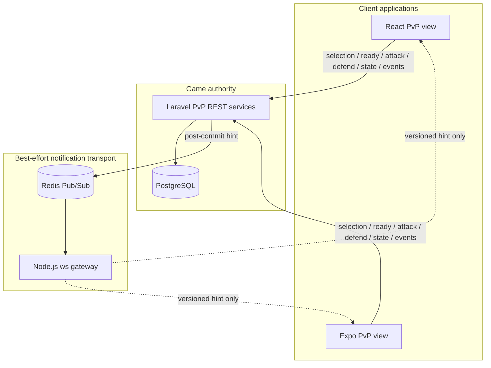
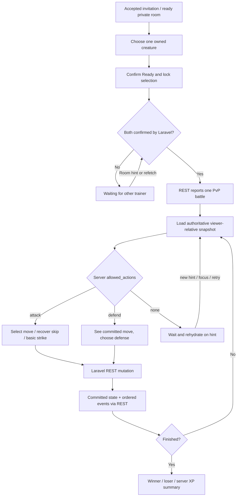

# Battle Arena — Phase 5B.3: PvP Arena, Realtime UX and Client Integration

**Status:** Implementation specification — Phase 5B.3 (not yet implemented)

**Prerequisites:** Phase 5A authenticated WebSocket transport, Phase 5B.1 private lobbies/invitations, and the locally implemented Phase 5B.2 authoritative two-human PvP battle engine.

**Deliverable:** A complete playable **private PvP experience on React Web and Expo Mobile**, from creature selection and Ready through live turn-based combat and the final result. **The server remains the only source of game truth.**

**Important baseline distinction:** The Phase 5B.2 work is reported as tested **locally but not committed or pushed**. This document does not claim to know its exact final DTOs, class names, routes, event payloads or test output. Cursor MUST inspect the local working trees and the actual Phase 5B.2 implementation and smoke document before choosing client contracts. The examples below are conceptual; adapt them to real code without weakening authority or security.

---

## 0. Required source documents and local audit

Read all of the following **in full**, not just headings:

1. `battle-arena-api/docs/PHASE5B2_PVP_BATTLE_ENGINE_SPEC_EN.md`
2. `battle-arena-api/docs/PHASE5B2_TWO_PLAYER_SMOKE.md` (when present locally)
3. `battle-arena-api/docs/PHASE5B_PVP_PRIVATE_ROOMS_SPEC_EN.md`
4. `battle-arena-api/docs/PHASE5A_REALTIME_NODE_WEBSOCKET_SPEC_EN.md` or its current revision
5. `battle-arena-api/docs/BATTLE_ENGINE_PVE_SPEC_EN.md`
6. The actual local sources and `.cursor/rules` in all five repositories.

Projects are sibling folders under `C:\FREELANCE\games`:

| Local folder | Responsibility |
| --- | --- |
| `battle-arena-api` | Laravel 13; session/bearer auth; PvP battle authority and durable read APIs |
| `battle-arena-realtime` | Node.js/TypeScript `ws` transport; GitHub repo `battle-arena-realtime-websocket` |
| `battle-arena-web` | React/Vite browser UI |
| `battle-arena-mobile` | Expo/React Native UI |
| `battle-arena-infra` | Existing Docker Compose stack |

**Preflight:** `git status` in each repository; inspect local uncommitted changes without overwriting them. Check exact contracts for room `ready` / `in_battle` / `closed`, selection and ready, battle state, attacker, defender, events and notification `pvp.battle.changed`. Examine any actual tests that define those contracts. Do not reconstruct a fake contract from this document. If the local 5B.2 backend is incomplete or inconsistent, describe the specific blocking issue, make only minimal justified contract repairs with backend tests, and preserve existing PvE APIs.

## 1. Scope and phase boundaries

### 1.1 Phase 5B.3 deliverables

- Complete private-lobby-to-battle flow on **both** React and Expo.
- Select a player-owned creature, confirm Ready, observe the other trainer's readiness, and transition to the battle once the authoritative room/battle state says it exists.
- PvP battle arena matching the established **Battle Arena** stadium, HUD, terminal-style combat log, action dock, colors, typography, audio and loading/error systems.
- The correct action panel for the authenticated player: **attack, defend, recover-skip, or wait** according to `allowed_actions` and server phase, with explicit pending-attack telegraph.
- WebSocket `pvp.battle.changed` integration as a **notification only**, followed by REST fetching of the latest state/events.
- Reliable rehydration after reconnect, refresh, screen resume, background/foreground, missed/reordered notification, and action response.
- Animated feedback and sound driven by **committed server events**, not optimistic predictions.
- Clear winner/loser result, actual server-awarded XP and resume/view-finished flow.
- Five supported locales: `en`, `fr`, `pt-BR`, `it`, `es`.
- Automated client tests, testable two-player smoke steps and a handoff to 5B.4.

### 1.2 Explicit exclusions

- Do **not** reimplement damage, moves, defense resolution, RNG, turn order, HP, PP, stamina, winner or XP on the client or in Node.
- Do **not** submit attacks or defenses over WebSockets. Commands use Laravel authenticated REST only.
- Do **not** design an alternate PvP engine or reuse `/api/pve/battles/*` endpoints for two players.
- Do **not** introduce matchmaking, public challenges, rankings, ladder, seasons, spectator access, chat or friends.
- Do **not** add disconnect auto-forfeit, AFK timers, authoritative per-turn deadlines or timeout XP policies; those belong to 5B.4.
- Do **not** flip `features.pvp` to `true` for general release. A restricted local development preview is acceptable; it must not bypass Laravel authorization or expose a released public feature.
- Do **not** require new Redis/PostgreSQL instances, a second Node service, Socket.IO or Laravel Reverb.
- Do **not** require new sprite import/migration to ship the arena; reuse available images and provide graceful fallbacks. Expanded animated Pokémon sprite catalog can be a separate visual enhancement.
- Do **not** auto-commit or push.

## 2. Ownership and security invariants

| Layer | Allowed responsibility | Forbidden responsibility |
| --- | --- | --- |
| Laravel | Identity, membership ACL, active turn, move legality, damage, resources, persistent snapshots/events, win/loss, XP | Trust client-submitted winner or client-calculated state |
| PostgreSQL | Durable game state and action/event history | Store ephemeral WS tickets in game tables |
| Redis | One-time tickets/grants; best-effort Pub/Sub | Be the canonical battle store |
| Node.js | Authenticate connection, validate one-time room grant, relay targeted hints, heartbeat | Query PostgreSQL, accept combat commands, infer membership from client frames |
| Web/Expo | Render viewer-scoped REST state; issue authenticated user actions; play visuals/audio | Manufacture turn results, reveal opponent private moves or RNG |

- The identity of each participant comes from the Laravel session or Sanctum bearer token, never from an editable `player_id`.
- A WebSocket `connection.ready` authenticates the connection only. Room delivery additionally requires the Laravel-issued, one-use room grant and a successful `room.subscribed` acknowledgment.
- Access to active and completed private battles is always checked by the Laravel API; the Node room subscription is not sufficient authorization for REST.
- Keep one-time tickets and grants out of logs, crash traces, telemetry, screenshots, persistent browser storage and query strings beyond the short-lived handshake.
- Server `allowed_actions` is the UI authority; the client can offer a friendly hint but cannot circumvent denial of a command.
- `expected_version` and the existing idempotency contract are mandatory for mutations. A retry of the same logical command uses the same key and identical request payload; a new choice uses a new key.
- Do not leak the opponent's unequipped/hidden moves, RNG state, access tokens or unpublished results through a tooltip, debug panel, WebSocket payload or analytics.

## 3. Reference architecture



**Notification contract:** The Phase 5B.2 suggested frame is `pvp.battle.changed`, carrying `room_id`, `battle_id`, `version`, `last_event_sequence` (plus outer `event_id`, `sent_at`, protocol version). The real local implementation is the contract: inspect it. Socket messages never carry combat calculations or private state. On a valid hint, fetch the authorized state/events via REST.

## 4. Navigation and end-to-end UX

### 4.1 Web and Mobile entry points

- Preserve existing `/pvp` React lobby and `app/pvp.tsx` Expo lobby, including invitations and inbox/outbox.
- Add the smallest appropriate battle route/screen, suggested Web `/pvp/battles/:battleId` and Expo `app/pvp/battles/[battleId].tsx`, or reuse an existing project convention if preferable.
- From an accepted private room, show selection and readiness. After both players lock, expose **Enter Battle** or navigate automatically only when Laravel returns a valid `battle_id`/`in_battle` state.
- Refresh/deep-link/reopen must load from REST, not require that a previous in-memory lobby UI was mounted.
- At the end of combat, let both participants view the final result without needing an active room subscription (consistent with 5B.2 participant read-only access).
- Existing lobby invite, decline, cancel and leave-before-battle continue to work. Do not map page refresh/navigation to a forfeit.

### 4.2 User journey



### 4.3 Lobby selection/readiness details

- Load **my eligible owned creatures** using existing collection APIs; reuse selection components if they fit; show name, level, silhouette/image and basic stats without leaking opponent collection.
- Send `owned_creature_id` using the locally implemented room selection endpoint; include expected room version and idempotency key as required.
- Display selected/locked states accurately; after Ready do not allow edits unless Laravel supports unlock/unready (do not invent one).
- Waiting view shows opponent trainer display name/handle and a generic readiness indicator; do not reveal their unconfirmed private selection unless the API explicitly permits it.
- If both Ready calls race, the client accepts the one unique server battle and resolves route from fetched room state; do not infer start from a local counter.
- If the room closes before battle, return to lobby/inbox with localized explanation, no result/XP.

## 5. Battle arena visual design

### 5.1 Layout

**Re-use the established simplified PvE design** rather than adding a separate tactical dashboard:

- One shared stadium image (`arena-bg.jpg`), using `cover` without stretching.
- Opponent occupies the upper-left/left battlefield zone; my creature occupies lower-right/right. Both sprites remain visually inside the arena on small screens; do not let sprite positions overlap the HUD or action dock.
- Compact HUD for **both** creatures: trainer display name, Pokémon name, level, HP and stamina; show PP only for my available moves.
- One terminal-style, scrollable battle commentary log adjacent to the arena on desktop and below it on narrow screens.
- Bottom action dock shows only the current valid action: attack selector, defense selector, or waiting indicator. Sticky placement must not cover a creature or HUD.
- A compact header displays room/battle identity or opponent handle, current phase, turn/round and connection state (connected/reconnecting/offline), without showing secret IDs as a primary UX element.
- Victory / defeat overlay and existing fireworks when appropriate; end-of-game server XP receipt and a clear **Back to Lobby** / **View Result** action.
- Use existing app design tokens, component conventions, loading GIF and localized feedback. Keep the battlefield as a single shared surface.

### 5.2 Responsive requirements

- Desktop: battlefield + fixed-height log column; dock beneath.
- Small screens: battlefield, fixed-height scroll log, and reachable dock in vertical flow. Support portrait devices, narrow phones, landscape, notches/safe-area insets, screen keyboard and rotation.
- Scale images with `contain`, not distorted; use `cover` for background only.
- Touch targets and text must be accessible; no essential action hidden below a clipped viewport.
- Preserve separate actual Web React and Expo React Native components; share pure TypeScript transformations and contract definitions where architecture allows, not React DOM code in React Native.

### 5.3 Basic component model (suggested, adapt to codebase)

| Web | Expo | Responsibility |
| --- | --- | --- |
| `PvpBattlePage` | `PvpBattleScreen` | Screen lifecycle and REST state orchestration |
| `PvpBattlefield` | `PvpBattlefield` | Arena, sprites, two HUDs |
| `PvpActionDock` | `PvpActionDock` | Attack/defense/wait, server action gating |
| `PvpCombatLog` | `PvpCombatLog` | Ordered narrative events, scroll and replay |
| `PvpOutcomePanel` | `PvpOutcomePanel` | Win/loss, actual XP and navigation |
| `PvpBattleAudio` | `PvpBattleAudio` | Volume/mute, cries, battle SFX and BGM |

Avoid duplicating business rules in component render functions. Prefer feature-scoped hooks/controllers, typed client adapters, pure reducers/selectors and accessible presentational components. Preserve PvE pages and their visuals; factor a small shared visual primitive only if it reduces duplication without regressions.

## 6. Viewer-relative state and action mapping

**Client source of truth:** the actual Laravel `GET /api/pvp/battles/{battle}` response and `GET /api/pvp/battles/{battle}/events?after_sequence=N` behavior. The Phase 5B.2 spec uses viewer-relative `me` / `opponent`, `current_attacker_user_id`, `current_defender_user_id`, `pending_attack`, `allowed_actions`, `phase`, `version`, `turn_number`, `last_event_sequence`, `outcome` as an *illustrative* target. Do not assume these exact keys if the local backend differs.

| Authoritative state | Client experience | REST operation |
| --- | --- | --- |
| Ready lobby; my selection editable | Choose owned creature / confirm Ready | Selection; Ready |
| Battle `awaiting_attack`; attack allowed | Moves with remaining PP + sufficient stamina; valid fallback only | Attack |
| Battle `awaiting_defense`; defend allowed | Show committed move telegraph; select one valid defense | Defend |
| Active; no action for me | Waiting for opponent; read-only HUD/log | None; wait for hint/refresh |
| Finished | Both results and server-awarded XP; no action controls | GET state and events only |

- `can_use`/PP/stamina eligibility displayed from server data where available. Do not enable an illegal move just because the client calculates sufficient stamina.
- Recover-skip: only offer when there is PP remaining but no move is usable, as **server-allowed**. On success the turn passes immediately; display the stamina gain and skipped attack in the log.
- Basic Strike: only offer when server allows it (original spec: PP exhausted); never use it to bypass stamina restrictions.
- Defense types: `endure`, `block`, `dodge`, `recover` with cost/description from rules/API. Grey out or omit unaffordable options as indicated by server.
- A committed attack is *not* damage. The defender should see the announced attack while HP and resources remain consistent until the defense result is committed.
- End-state user perspective: do not assume host=winner or my creature = `player` in the PvE sense; derive result from the authenticated participant's relationship to durable server winner/loser IDs.
- Never locally rewrite the canonical `version`, `last_event_sequence`, HP, stamina, PP or result based on animation state.

## 7. REST mutations, retries and conflict handling

### 7.1 Action submission pattern

1. Read latest authoritative state, version and `allowed_actions`.
2. When the user explicitly presses an enabled action, create an `Idempotency-Key` and freeze the exact request payload (`move_id`/`recover`/`basic_strike` or `defense`, `expected_version`, any required room/battle ID).
3. Disable duplicate submission for that logical action; keep the same request ID/key for uncertain transport retry of the **same** payload.
4. On successful REST response, update from the **server response**, then rehydrate state/events if the response omits part of the current snapshot.
5. On a stale version (`409`) or action-phase conflict, fetch fresh state and events; clear pending UI choices as needed; present a friendly localized notification. Never auto-submit the old choice against the new phase.
6. On transport timeout/uncertain outcome, first fetch authoritative state; if a retry is still necessary, use the **same key + identical payload**. Do not create a second action simply because the request timed out.
7. On a definite validation rejection, retain the game state and offer the appropriate action again, using a new key for a new logical user choice.

### 7.2 Concurrency and lifecycle

- Prevent double-clicks, duplicated effects, cross-tab races and request responses arriving out of order. Discard stale fetched snapshots by monotonic battle version.
- A websocket hint can arrive before the corresponding UI mutation promise resolves; coordinate rehydration to prevent older result overwriting newer state.
- Switching tabs, minimizing the app, refreshing or navigating away **must not** call `abandon`/`forfeit`. Leaving an *active battle* is not equivalent to an intentional surrender and surrender has not been implemented in 5B.3.
- An intentional navigation action may warn the player that the battle stays ongoing; do not invent a loss on exit.
- When no active battle is found or room is closed, present a recoverable, localized state rather than a blank page or infinite spinner.

## 8. WebSocket lifecycle and REST rehydration

### 8.1 Reuse the existing realtime session

- Reuse/extensively **extend** the Phase 5B.1 `PvpRealtimeSession`/equivalent rather than creating a second competing WebSocket for the same user.
- Authenticate via `POST /api/realtime/tickets`, connect with the short-lived one-use ticket, await `connection.ready`, issue a new room subscription grant from Laravel and wait for `room.subscribed` acknowledgment.
- Add handling for `pvp.battle.changed`. Every accepted hint schedules a REST state refresh (or ignores it only if a strictly newer/equal version is already confirmed locally).
- Deduplicate `event_id` within a bounded cache; ignore hints for unrelated room/battle IDs, obsolete versions and invalid payloads.
- On room revocation, stop room delivery and do **not** interpret it as a loss; fetch current room/battle state. Final results must be accessible via REST for recorded participants.
- On reconnect, obtain **fresh ticket and grant**; old tickets/grants are one-use. Manage timers and event handlers without duplicates or leaking sockets.
- Connection drops do not automatically defeat a trainer or change their server match state.

### 8.2 Recovery triggers

On mount/deep-link, after every own action, on valid battle hint, after WebSocket reconnection, browser `visibilitychange`/focus, Expo `AppState` resume, and explicit **Refresh**:

1. Fetch authoritative battle state for the logged-in user.
2. Compare `version` with current state; apply only if not older.
3. Fetch events after last contiguous applied sequence (or fetch full/paginated history if sequence is lost).
4. Detect missing event sequence and repair using REST before showing a new resolved exchange.
5. If state is final, show final result even if no socket subscription is available.

If the WebSocket is unavailable, REST actions must still function; provide a clear degraded **Reconnecting / Refresh** status. A lightweight bounded fallback poll (e.g. every 10–20 seconds while a battle is visible) is acceptable when hints are unavailable, avoiding simultaneous flood and pausing appropriately in background. Polling must not become the primary authority.

### 8.3 Event interpretation

- Server events/history are ordered by numeric sequence. Merge by unique stable ID or `(battle_id, sequence)` without duplicating log entries.
- Never replay all old SFX/animations after page reload. Initial load shows history; **only newly committed events** animate, unless the user explicitly chooses Replay.
- If events are incomplete, preserve accurate HUD/result and label the narrative as refreshing until history catches up.
- Store replay cursor or history references only as a convenience; never persist the canonical battle state as an alternative to REST.

```mermaid
sequenceDiagram
  participant P1 as Player A UI
  participant API as Laravel API
  participant NODE as Node WS
  participant P2 as Player B UI
  P1->>API: POST attack (expected_version, idempotency)
  API-->>P1: Committed authoritative state
  API-->>NODE: post-commit pvp.battle.changed hint
  NODE-->>P2: Scoped room hint
  P2->>API: GET battle snapshot / events
  API-->>P2: Pending announced move; defense allowed
  P2->>API: POST defend (expected_version, idempotency)
  API-->>P2: Resolved authoritative exchange
  API-->>NODE: New versioned hint
  NODE-->>P1: Scoped room hint
  P1->>API: GET battle snapshot / events
  API-->>P1: New HP/stamina/PP and turn owner
```

## 9. Commentary log and battle motion

### 9.1 Narrative requirements

For each resolved attack/defense exchange display, using API-authorized event data:

- Attacker name, defender name, move name.
- PP and stamina spent, when available.
- Defender reaction (`endure`, `block`, `dodge`, `recover`) and any effective reduction/avoidance.
- Final damage, HP before/after, misses/immunity, KO and victory/defeat.
- Recover-skip events, with stamina restored and skipped attack.
- Server XP on combat completion (never guess award amount).

Use the **one combat log** approach already implemented in PvE. Keep chronological order and an accessible text version even when animated playback is enabled. Prefer renderer transformations of server data rather than making the backend return English sentences. All templates must be localized.

### 9.2 Visual motion — presentation only

| Trigger from committed events | Visual reaction |
| --- | --- |
| Idle | Gentle independent sway/bob; no server mutation |
| Attack committed but not resolved | Short anticipation or telegraph (optional); **no damage yet** |
| Exchange resolved | Brief lunge/flash for attack, impact effect, HUD transition to committed values |
| Dodge | Quick lateral movement and return |
| Block | Brief shield/impact pulse |
| Recover | Subtle glow/pulse |
| Miss/immune | Feedback without fake damage |
| Knockout | Fade/desaturate/faint based on final result |
| Victory | Existing fireworks, banner and result sound |
| Defeat | Localized defeat banner and result sound |

Animations must not delay REST state truth. If a new authoritative state arrives while a previous animation is playing, queue only bounded visual transitions and allow skip/cancel; never block controls indefinitely. On restored pages, show current state immediately. Respect reduced-motion settings and avoid flashing/strobing effects.

### 9.3 Sprite and asset strategy

- Reuse `arena-bg.jpg`, the existing creature `image_ref`/`image_url` and all previously shipped SFX/BGM/cry integrations where available.
- Keep player and opponent sprites independent from stadium background.
- If the API **already exposes** animated front/back sprites at implementation time, prefer them by perspective with fallback. **Do not construct remote URL guesses** or add PokéAPI calls at runtime.
- If not available, ship with current static artwork + subtle UI motion. A full animated-sprite import pipeline is optional and separate from 5B.3.
- Expo animated formats must be tested on Android and iOS; fallback to static images if unsupported or expensive.

## 10. Audio experience

- Reuse Web/Expo battle music and sound managers rather than opening duplicate audio contexts/players.
- At battle entry, if available: opponent cry, then own creature cry, then localized start announcement; play only once per **new** battle session, not on every REST rehydrate or rerender.
- Reuse existing BGM, attack SFX and outcome SFX. Action sounds should follow **accepted/committed server events** when relevant to the outcome; avoid a speculative victory sound on a failed action.
- BGM volume should permit cries/effects to be heard; preserve sound/music mute choices, ideally across screens using existing settings pattern.
- Handle browser autoplay policies, mobile audio lifecycle, muted users and permission/codec failures without breaking gameplay.
- Do not play all historic sound effects on reconnect or while restoring event history.
- Do not add unlicensed copyrighted audio assets; existing assets must be handled according to project licensing.

## 11. Internationalization, accessibility, errors

Supported locales **exactly**: `en`, `fr`, `pt-BR`, `it`, `es`.

Text needing locale coverage includes: select creature, selection locked, Ready/waiting, entering battle, your turn, opponent turn, attack/defense, pending declared move, costs, recover-skip, Basic Strike, disconnected/reconnecting/reconnected, stale state, room closed, won/lost, XP, loading/error/empty states, combat commentary and action announcements.

- Use Web `pvp.json` and Mobile `pvp.*` according to current i18n conventions.
- Backend code/error envelopes remain source for machine-readable errors; translate to friendly UI strings without raw HTTP traces or internal IDs.
- Make action controls keyboard and screen-reader usable. Announce turn changes and result with accessible live/status regions (without flooding every HP event).
- Honor system reduced motion; make sound independent of accessibility status.
- Color should never be the sole signal for turn/HP or win/lose.
- Make loading/error boundaries resilient; use existing centered `loading.gif`/`PageLoading` or `LoadingState` conventions.

## 12. Test strategy and QA matrix

### 12.1 Pure frontend unit tests

- Normalizers/selectors of actual battle DTOs; role and allowed-action mapping.
- Render own attack, enemy pending move / defense, waiting and finished views correctly.
- Reject UI submission when `allowed_actions` or `can_use` forbids it.
- Stable action idempotency/retry key behavior for uncertain HTTP outcomes; stale version handling.
- Deduplicate `event_id` and event `(battle_id,sequence)`; ignore out-of-order stale snapshots; repair event gaps.
- Log formatting for attack, defender reaction, miss, recover-skip, KO and XP.
- No repeated intro/audio on rehydrate; handle reduced motion.

### 12.2 Client integration tests

- Room selection + Ready + transition to existing `battle_id` with no duplicate creation.
- WebSocket hint triggers REST fetching, never direct HP or outcome mutation.
- Two simulated clients: A attacks; B receives hint, fetches pending attack and defends; A sees response; turns swap.
- Both sides display correct viewer-relative creature, HP and allowed controls.
- WS disconnected: user can refresh and still act via REST; reconnect gets new tickets/grants.
- Room subscription revoked on finish: GET final match still works for both players; unrelated user cannot read the match.
- Page reload/back navigation does **not** auto-forfeit.
- No duplicate submission after double tap, retry or overlapping responses.
- Five-locale strings present; basic accessibility/keyboard assertions.

### 12.3 Manual smoke — use real 5B.2 smoke path

Use the locally implemented `PHASE5B2_TWO_PLAYER_SMOKE.md` as the backend baseline and extend it with Web + Expo UI paths. At minimum:

1. Two independent authenticated accounts, both level 6+ and each owning a valid battle creature.
2. Private invite from A to B; B accepts.
3. A selects a creature and locks Ready. B does the same. Exactly one battle starts.
4. A and B each confirm correct perspective: my creature vs opponent, own allowed action only.
5. A attacks; B sees committed move, not premature damage; B defends; both see same authoritative HP/stamina/PP and swapped actor.
6. Try recover-skip when eligible and Basic Strike after move PP is exhausted.
7. Complete one KO; both see winner/loser and correct server XP (winner +20, loser +10) once.
8. Refresh both sides mid-battle; background/resume Expo; disconnect Node temporarily and use REST; reconnect with new ticket/grant.
9. Verify outsider cannot load private battle; replay action/version conflict does not corrupt the UI.
10. Test narrow mobile portrait, desktop, Web+Expo mix, all five languages and audio muted/unmuted.

Use test fixtures/factories; do not casually change production user levels or grant XP manually. Do not claim real-device testing if not performed.

### 12.4 Commands and CI

- Web: run repository lint, typecheck, Vitest and build scripts in a supported Node version; `Node 22+`/Compose Web may be required (host Node 20 previously failed on Web Vitest).
- Mobile: lint/typecheck and applicable tests with the project's current Expo toolchain; validate native/runtime behavior when possible.
- Node: if touched, run its unit/integration tests and typecheck.
- Laravel: if touched, run focused PHPUnit and existing PvE/PvP regression suite; use PostgreSQL for true concurrency tests.
- Infra: if touched, run `docker compose config` and non-destructive health/smoke verification.

Never turn failures into silent passes. Report skipped tests/environment restrictions explicitly.

## 13. Implementation milestones

| Milestone | Work | Acceptance |
| --- | --- | --- |
| **U0** | Inspect local 5B.2 contracts, smoke guide, working trees, UI patterns and `.cursor/rules` | Actual DTO/routing map and no lost local changes |
| **U1** | Typed REST adapters, normalizers and lobby creature/Ready UI | Selection, ready, one battle discovery; test coverage |
| **U2** | Web arena, per-role action dock, log, outcome | Complete PvP flow using Laravel responses; accessible + responsive |
| **U3** | Expo arena and same server/phase flow | Phone-friendly layout and correct input states |
| **U4** | Realtime hint adapter, dedupe, REST rehydrate, reconnect/visibility behavior | Two clients stay synchronized despite lost hints |
| **U5** | Audio/motion, translations, security & E2E tests, docs/rules | Existing PvE/lobby green; demonstrable full two-player UI |

Implementation may overlap U2–U4 as justified. Do not stop after drafting a plan; complete and test the client integration.

## 14. Definition of Done

- [ ] Both Web and Expo let two real users choose owned creatures, Ready and enter one server battle.
- [ ] Both UIs show correct attacker/defender perspective and only server-authorized actions.
- [ ] Attack commitment, defense resolution, recover-skip, KO and final XP work through REST.
- [ ] Every socket hint leads to a safe REST rehydrate; reconnect and missed notifications recover.
- [ ] Refresh, navigation, tab hide and mobile background **never** auto-abandon an active match.
- [ ] No hidden opponent move/secret or forged outcome is exposed in UI/logs.
- [ ] Single stadium, HP/stamina HUDs, accessible narrative log, action dock and result UI work responsively.
- [ ] Existing arena background, loading, cries/BGM/SFX and localizations are reused reasonably; no mandatory new sprite provider.
- [ ] Web and Mobile tests, lint and typecheck pass, and smoke is attempted with honest evidence.
- [ ] Existing Phase 5A/5B.1/5B.2 and PvE behavior remain intact.
- [ ] `features.pvp` **remains false** pending the Phase 5B.4 release gate.
- [ ] No automatic commits, remote pushes or destructive Docker/DB operations.

## 15. Phase 5B.4 handoff — specifically deferred

- Explicit surrender/forfeit policy and its server-authoritative outcome/XP treatment.
- Disconnect grace periods, AFK/per-turn timeouts, policies for crashed/absent players, and abuse resistance.
- End-to-end real-device and two-real-account hardening, accessibility audit, performance/observability metrics, load/soak tests.
- Final security checks, release management, monitored rollout, and decision to set `features.pvp = true`.

**End of Phase 5B.3 specification.**
