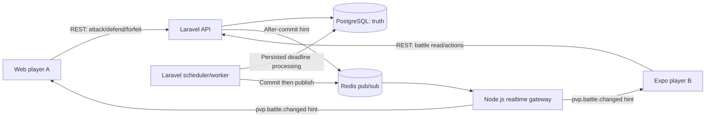
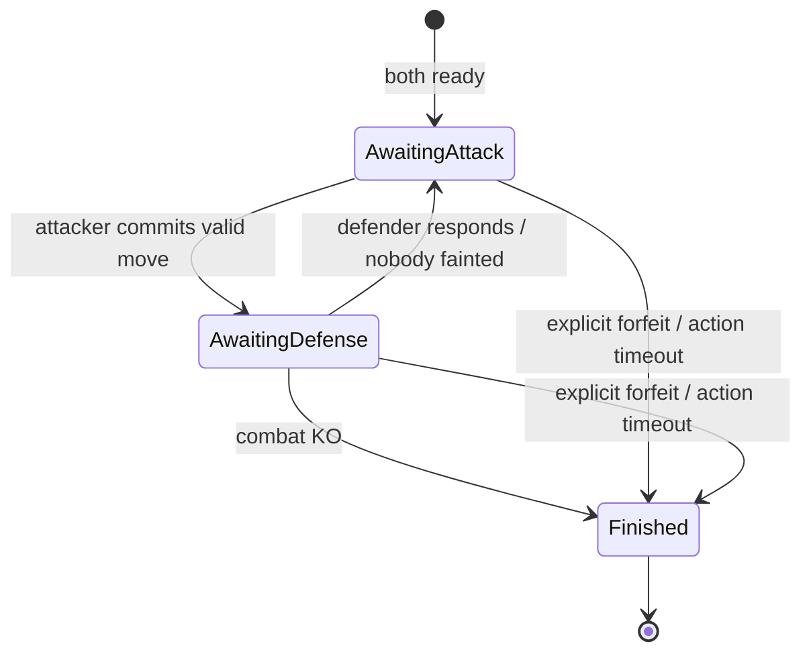
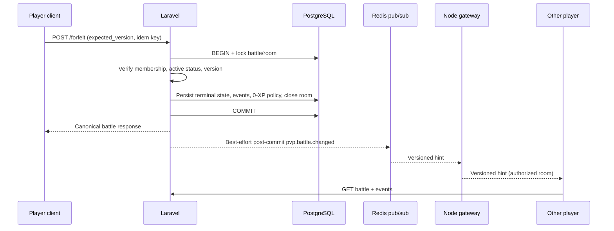

# Battle Arena — Phase 5B.4: Private PvP Stability, Fair-Play & Release Readiness

**Status:** IMPLEMENTATION SPECIFICATION — not a claim of completed implementation or release  
**Scope:** stabilize two-human **private** PvP, formalize explicit forfeit/turn timeout, test the complete Web/Expo experience, prepare a safe release gate.  
**Version:** 1.0 — November 26, 2026  
**Source repositories:** `battle-arena-api`, `battle-arena-realtime` (GitHub: `battle-arena-realtime-websocket`), `battle-arena-web`, `battle-arena-mobile`, `battle-arena-infra`.

## 0. Read-first baseline

Consult the real local working tree, not just GitHub `main`:

- `docs/PHASE5B_PVP_PRIVATE_ROOMS_SPEC_EN.md` — invitation and room authority.
- `docs/PHASE5B2_PVP_BATTLE_ENGINE_SPEC_EN.md` — authoritative two-human combat.
- `docs/PHASE5B2_TWO_PLAYER_SMOKE.md` — existing backend smoke path.
- `docs/PHASE5B3_PVP_ARENA_REALTIME_UX_SPEC_EN.md` — clients and hint-only synchronization.
- `docs/PHASE5B3_TWO_CLIENT_UI_SMOKE.md` — UI smoke path.
- Phase 5A realtime authentication specification.
- `docs/BATTLE_ENGINE_PVE_SPEC_EN.md` — preserve PvE regression behavior.
- Every applicable `.cursor/rules/*.mdc` file in the five repositories.

### Verified remote baseline (November 26, 2026)

| Repository | Relevant `main` commit | Evidence |
|---|---|---|
| API | `48966fa` | Lobby battle pointers and viewer-relative PvP battle contract |
| Web | `373ec3b` | PvP arena and REST rehydrate |
| Mobile | `3b7b1ba` | Expo arena and lobby |
| Realtime gateway | `5ad2b99` | Hint-only `pvp.battle.changed` fanout |
| Infra | `96581c4` | Compose orchestration and room grant transport |

These are a **baseline**, not an assertion that local changes are identical. Inspect `git status` and source before editing.

### Known quality gaps from 5B.3 handoff

1. Two-user browser/browser and browser/Expo live smoke matrix was **documented, not executed**.
2. Real-device iOS/Android runtime was **not verified**.
3. Mobile `npm run typecheck` has three previously existing `TFunction` TypeScript errors in `app/pve.tsx`; PvP-specific files were not implicated.
4. Host Node 20 cannot run the current Web Vitest stack; use Node 22+ or `docker compose exec -T web`.
5. `features.pvp` is still **false**. PvP release is **not approved** by creating this document.
6. Disconnect, refresh and backgrounding currently do not auto-forfeit; preserve this property.

## 1. Release goals and explicit exclusions

### Required Phase 5B.4 outcomes

- A deliberate, authenticated, confirmation-protected **forfeit** command with server-verified result.
- A robust, *server-timed* **action deadline** policy, configurable and disabled until validated.
- Correct battle completion, room lifecycle, event ordering and reward idempotency in both paths.
- Recoverable networking: REST remains authoritative when WebSocket/Redis signaling is unavailable.
- Cross-client visible deadlines, countdown, reconnect/resume, and final outcomes.
- Reliable CI and regression tests; two real authenticated users in acceptance smoke.
- Measurable operational health, audit-safe telemetry and safe feature rollout/rollback.
- Written release decision with evidence, not automatic flag flipping.

### Explicitly excluded

- Matchmaking, public queues, Elo/MMR, leaderboards, ranking, seasons, tournaments.
- Gameplay commands or battle-state calculations inside the Node gateway.
- A second Redis or PostgreSQL service; paid infrastructure requirements.
- Replacing the existing PvE Battle Engine or rewriting Phase 5B.2 combat math.
- GIF/sprite import overhaul and bespoke per-move sound library (separate optional visual phase).
- Destructive Docker reset, rotating `APP_KEY`, auto commits/pushes, or production deployments.

## 2. Architecture invariants



- Laravel validates Sanctum identity, PvP eligibility, membership, actor turn, expected version, action options, RNG and XP.
- PostgreSQL stores rooms, members, battles, action ledgers, deadlines, events and terminal outcome.
- Redis holds short-lived WS tickets/room grants and best-effort fanout, **never canonical timers or winner state**.
- Node.js sends only validated change notifications to existing Laravel-authorized room subscribers; no SQL access or action logic.
- Web/Expo receive hints, compare versions and fetch authoritative `GET /api/pvp/battles/{battle}` and events.
- A WebSocket being open is not permission to see a private battle. Room grants remain necessary.

## 3. Existing API surface (do not rename)

The current 5B.2 contract includes:

```text
PUT  /api/pvp/rooms/{room}/selection
POST /api/pvp/rooms/{room}/ready
GET  /api/pvp/battles/{battle}
GET  /api/pvp/battles/{battle}/events
POST /api/pvp/battles/{battle}/attack
POST /api/pvp/battles/{battle}/defend
```

Related existing 5A/5B.1 routes:

```text
POST /api/realtime/tickets
POST /api/pvp/rooms/{room}/subscription-grants
GET  /api/pvp/rooms/{room}
POST /api/pvp/rooms/{room}/leave
```

The existing `PvpBattlePresenter` exposes viewer-relative `me`, `opponent`, `allowed_actions`, `pending_attack`, `phase`, `version`, `turn_number`, `last_event_sequence`, `outcome`, `rewards` and room ID. **Extend additively** (e.g., `action_deadline_at`); do not change unrelated shapes or expose opponent move choices. The authoritative schema and migrations must be inspected in the working tree.

### Proposed *new* endpoint

```text
POST /api/pvp/battles/{battle}/forfeit
Authorization: session cookie or bearer (Sanctum)
Idempotency-Key: UUID or other bounded client-generated string
Content-Type: application/json

{
  "expected_version": 12
}
```

Do not reuse the lobby `leave` endpoint as a combat forfeit. If `POST /rooms/{room}/leave` is currently allowed during an active battle, audit and change it so it **cannot silently abandon or terminate** active combat; return a domain error indicating that `forfeit` is the explicit choice. Preserve valid pre-battle leave behavior.

On success, return the normal viewer-relative battle representation and canonical event sequence. On replay with the same idempotency key and payload, return the recorded result; on same key with different payload, reject. On stale version return existing structured conflict/409 contract and ask the client to refetch, **never auto-resubmit**.

## 4. Proposed MVP gameplay policy — MUST be reviewed before public release

The following values are **project recommendations, not previously agreed facts**. Implement as configurable rules with tests, expose only appropriate metadata and record final selection in a documented ADR. Avoid silently changing these values later.

| Situation | Recommended MVP handling | XP |
|---|---|---|
| Normal combat KO | Existing 5B.2 win/loss | Winner **+20**, loser **+10** (from versioned battle reward snapshot) |
| User explicitly forfeits active battle | Forfeiter loses; other participant wins; terminal `end_reason=forfeit` | **0 for each** to limit XP farming during private PvP preview |
| Active player misses server action deadline | Timed-out active player loses; other participant wins; `end_reason=timeout` | **0 for each**, proposed MVP anti-farming policy |
| Leaving unstarted invitation/room | Existing lobby close/cancel semantics | **0**; no win/loss record |
| Browser refresh, app background, transport disconnect | **No immediate forfeit**, normal REST resume | No outcome or XP change |
| Redis/pubsub unavailable | REST actions continue if authoritative dependencies remain healthy | No automatic loss |
| App server/DB unavailable | Surface network/retry UX; never let Node determine result | No unverified XP |

**Configuration proposal:**

```text
PVP_FORFEIT_ENABLED=true              # feature may be tested locally before public release
PVP_TURN_TIMEOUT_ENABLED=false       # enable only after scheduler + UI + smoke pass
PVP_TURN_TIMEOUT_SECONDS=300          # proposed default: five minutes for each action decision
PVP_NONCOMBAT_WIN_XP=0                # proposed, not a historical rule
PVP_NONCOMBAT_LOSS_XP=0               # proposed, not a historical rule
PVP_PUBLIC_ENABLED=false             # public flag stays OFF until approval
PVP_PREVIEW_ENABLED=false            # optional, explicitly gated non-production preview
```

Prefer central game/config rules and validated bounds over unsupervised arbitrary environment switches. The public `features.pvp` representation and backend route gate must have consistent semantics. Require an **explicit human decision** on noncombat rewards and timeout duration before enabling public PvP. Any final decision must be snapshotted/versioned where it affects a running battle.

### Timing rules and fair-play

1. A deadline is tied to the current *action decision*, not connection status: `awaiting_attack` requires attacker action; `awaiting_defense` requires defender action.
2. On battle start or every phase transition, store a new authoritative UTC `action_deadline_at` and which actor/phase/version it belongs to. A valid on-time mutation updates it atomically.
3. When time has passed, a **Laravel-owned** service checks the locked row and resolves at most once. A client clock cannot declare timeout.
4. Refresh/reconnect does not reset or extend a pending deadline. WebSocket reconnect does not count as activity.
5. If a combat action and timeout race, PostgreSQL row locking plus expected version and deadline check must produce **one** winner/loser and one terminal event.
6. Laravel scheduled processing is safe to retry and to run concurrently; use command + scheduler or queue infrastructure already present. Avoid Redis-only countdown timers or per-socket timers for adjudication.
7. The client may display a countdown from server UTC time, but only server resolution determines expiration; handle timer drift and stale snapshots.
8. A user whose connection drops is not immediately forfeited. They may still lose **later** if the independently persisted action deadline expires — explain clearly in UX.
9. For operational outage or postponed launch, the system must support disabling timeout adjudication without touching stored battles; document whether paused deadlines are extended, honored or recalculated before re-enabling. **Never silently mass-forfeit after a prolonged outage.**

### UX language warning

“Connection lost” **must not** appear as “You forfeited.” Show “Connection interrupted; reconnecting. Your turn timer may continue.” and a manual Refresh option; translate in en, fr, es, it, pt-BR.

## 5. State machine, terminal transitions and race safety

Existing `PvpBattle` is `active|finished` and uses phases `awaiting_attack|awaiting_defense|finished`. Extend without breaking the 5B.2 engine contract:



- Keep battle terminal reasons distinguishable: `combat`, `forfeit`, `timeout` (schema/model enum/constants, not unvalidated arbitrary strings).
- Store `winner_user_id`, `loser_user_id` and **optional** `forfeiting_user_id`/`timed_out_user_id`, event details and timestamp. Avoid storing ambiguous client booleans.
- Preserve the pending committed attack snapshot on row lock until resolution, and clear it on terminal; a forfeit during defense must not inadvertently apply damage or spend PP/stamina.
- End game even if the forfeiting participant was not the current actor (explicit forfeits are allowed from either participant).
- A battle already terminal cannot be further attacked, defended, forfeited or timed out. Idempotent request replay of the terminal action is distinct from a new action and must be safe.
- Close room using existing lifecycle semantics, correctly revoke room subscriptions as needed **after outcome is persisted**, and keep completed result retrievable by both participants.
- A room should not start a second battle unless separately authorized by future features.
- Nonparticipants should receive the existing private not-found/forbidden behavior. Avoid leaky error distinctions.
- Guard against both players forfeiting simultaneously, timeout vs defense, duplicate requests, restarted workers, and multi-tab duplicate actions.

### Transaction model



For guaranteed delivery in later phases, evaluate a transactional outbox; **do not silently describe Redis pub/sub as durable**. In 5B.4 best-effort hint + REST rehydrate is acceptable with reliable fallback polling/focus refresh.

## 6. Reward processing & anti-abuse

- Normal combat rewards remain server-derived and versioned: current config shows `pvp.win=20`, `pvp.loss=10`.
- New non-combat rewards use a **separate policy branch**; do not call `BattleRewardService` to accidentally award the normal +20/+10 on forfeit or timeout.
- Record terminal outcome and explicit reward results (including zero if chosen) in the existing `pvp_battle_rewards` data model, consistently with existing battle response contracts.
- If `xp_awarded = 0`, do not create a positive XP progression event. `rewards_processed` remains an exactly-once terminal invariant.
- Use unique database constraints/idempotency keys to prevent duplicate payout, especially in concurrent terminal paths.
- Capture relevant rule/reward version at battle creation, and use those snapshots when finishing matches.
- Keep awarded XP private to authorized participants; no public per-player battle disclosure.
- Do not implement competitive ELO/rating or abuse heuristics before Phase 6; report suspicious repeat-forfeit volume operationally without exposing identities in logs.

## 7. Backend implementation guidance

Primary files to inspect first:

```text
battle-arena-api/app/Application/Pvp/PvpCombatService.php
battle-arena-api/app/Application/Pvp/PvpBattlePresenter.php
battle-arena-api/app/Application/Pvp/PvpBattleStateMapper.php
battle-arena-api/app/Application/Pvp/PvpLobbyService.php
battle-arena-api/app/Application/Pvp/PvpRealtimePublisher.php
battle-arena-api/app/Domain/Battle/Pvp/PvpTurnEngine.php
battle-arena-api/app/Domain/Pvp/Models/PvpBattle.php
battle-arena-api/database/migrations/2026_11_25_070001_create_pvp_battle_tables.php
battle-arena-api/config/pvp.php
battle-arena-api/config/game.php
battle-arena-api/routes/api.php
```

**Required implementation principles:**

- Introduce small application services for `forfeitBattle` and `expireOverdueAction` or equivalent; avoid adding a giant branch to the current ~28 KB `PvpCombatService`.
- Reuse existing battle-finish persistence and room-close/reward patterns where safely possible; extract shared terminal application service as needed, not duplicated combat math.
- Add one **additive** migration for deadlines/terminal metadata, respecting existing data. No destructive migration, no dropping tables/volumes.
- Use injectable `Clock`/`Carbon` time and deterministic tests (time travel), never sleep-based flakiness.
- A batch timeout runner selects due active rows with bounded query, index and appropriate row-lock/skip-locked or claim strategy on PostgreSQL. Validate actual DB behavior and Laravel APIs. No N+1 scan of all battles.
- Check current active-deadline freshness on every action, so scheduler latency cannot let a late action win a race. If a late action arrives, resolve or reject safely according to the defined transition policy and return refetch guidance.
- Preserve existing error-envelope shape, `PVP_*` code naming, translations, OpenAPI fragment conventions and route throttles.
- Ensure normal combat completion does not mistakenly trigger timeouts after it has finished.
- Do not enable public PvP by default, and do not expose debug or admin timeout endpoints publicly.

## 8. Realtime gateway guidance

Existing gateway already accepts room grants, `room.subscribe`, `room.unsubscribe`, and forwards `pvp.battle.changed` by room. Prefer **no Node changes** unless needed for a concrete failing test or schema extension. If needed:

- Continue emitting only `{ battle_id, room_id, version }` type identifiers and monotonic version hints; never raw combat math, opponent private moves, XP calculations or authoritative timer state.
- Preserve protocol `v=1`, ticket auth, room-grant ACL, heartbeat, origin checks, backpressure limits and redaction.
- Never interpret WebSocket `disconnect`/`close` as `forfeit`; never add combat WS command types.
- Respect private room subscription revocation and avoid leaking closed battles to outsiders.

## 9. Web & Expo UX requirements

Existing Web page: `src/features/pvp/pages/PvpBattlePage.tsx`; existing Expo route: `app/pvp/battles/[battleId].tsx`.

- Add a visible **Forfeit battle** action only for active participant and an explicit confirmation dialog/modal; destructive action has a distinct tone and cannot be triggered by accidental navigation.
- Show server-sourced `action_deadline_at` and a local *visual-only* countdown; only active actor gets warning, but both may see deadline (if exposed by API). Never use the countdown to decide loss on client.
- On successful forfeit/timeout return to a readable result, including `end_reason`, winner/loser, and exactly the XP awarded (possibly 0). Do not invent XP in the client.
- Keep existing battle animation, background audio, attack/defense dock and combat log intact; avoid re-running animations/SFX for old events after restore.
- Handle 409 by REST rehydrate, no automatic mutation retry. Preserve an idempotency key for one deliberate retry of the *same* operation only.
- On REST 503/network failure and WS drop, show recoverable status; a disconnected client must not fire a forfeit request from `pagehide`, unmount, `beforeunload`, Expo AppState or navigation.
- On focus/resume/reconnect and WS hints, GET battle/events; reject stale versions and dedupe event IDs/sequences.
- Respect reduced-motion and audio preferences. Provide readable loading, empty, waiting, timed-out and terminal states.
- Keep all text translated in en, fr, es, it and pt-BR with actual localization keys (not hard-coded English).
- Improve mobile portrait/responsive overlap and safe areas; no oversized full-screen confirmation on small devices.
- Fix the known pre-existing Expo `TFunction` type mismatch in `app/pve.tsx` with a minimal type-safe refactor, without changing PvE gameplay.

## 10. Security and accessibility gates

- `auth:sanctum` for all state-changing/read-private endpoints; ownership verified server side for both action and result.
- Verify `expected_version`, acting player, terminal status, idempotency key and action conditions inside DB transaction.
- Rate-limit explicit forfeit (by user/battle) and reject duplicate same-version commands; avoid sending public battle IDs in logs with PII.
- Never expose RNG seed, raw opponent private move slots, bearer tokens, WS tickets or Redis grants in API payloads, analytics, errors or logs.
- Validate that active room `leave` endpoint cannot become an implicit active battle forfeit.
- Web: keyboard-accessible modal with focus management and no accidental Enter submission. Mobile: accessible labels, readable dialog, safe area and screen reader support.
- Treat API and Node as separately deployable; WS downtime must not silently break REST action buttons.
- Feature gate **backend and navigation** consistently. Recommended: separate private dev preview from public `features.pvp`. Production must not gain public access merely because a frontend link is hidden.

## 11. Test matrix (automated)

**Laravel PHPUnit / PostgreSQL integration**

1. Forfeit by host while attacker; by guest while defender; and during either phase.
2. Idempotent same request replay; conflicting payload reuse; stale `expected_version`.
3. Unknown battle, outsider, non-member, unauthenticated, ineligible actor cases.
4. Forfeit vs defend concurrently; forfeit vs forfeit concurrently; timeout vs action concurrently; no duplicate payouts/events.
5. Deadline creation on battle start, on attack commit, after defense, after recover-skip; no deadline after KO.
6. Scheduler retries; claimed-row concurrency; crash/restart and delayed ticks; backlog only processes due rows.
7. `features.pvp=false` public gate / preview gate; normal existing 5B.2 in-preview behavior remains possible for tests.
8. Each terminal `end_reason` stored and presented correctly; completed result accessible to both participants only.
9. 0/0 noncombat XP proposed policy, normal 20/10 combat XP unchanged; no extra player XP events.
10. Redis fanout failure after DB commit does not lose authoritative result.
11. End-of-battle room subscriptions revocation, room closed correctly, no subsequent actions.
12. PvE and auth regression tests must remain green.

**Node/Vitest**

13. Private fanout only to room authorized members; closed room revocation.
14. Invalid/mismatched grant rejection; Redis unavailable fail-closed for new room subscriptions.
15. WS messages cannot contain gameplay commands; close/reconnect never triggers forfeit.
16. Existing Phase 5A heartbeat and connection tests remain green.

**Web/Expo**

17. Forfeit confirmation/cancel, translation, terminal outcome/XP from REST.
18. Countdown display, stale version and delayed timeout result; `onFocus` refetch.
19. No forfeits on refresh/navigation/backgrounding; WS down REST fallback.
20. Typecheck, lint, unit tests and production build if supported by repo.
21. Confirm fixing `app/pve.tsx` TFunction errors does not regress the PvE component.

Prefer the existing Docker Compose test environment over the host Node 20 installation for Web Vitest. Do not claim Web+Expo physical-device coverage unless actually executed.

## 12. Manual acceptance & evidence

Execute the detailed matrix in **`PHASE5B4_TWO_PLAYER_RELEASE_SMOKE_EN.md`**. Record date, environment, browser/device names, tester, result, screenshots/log references and blockers for each item.

Minimum evidence for a release recommendation:

- Two distinct authenticated trainers level >= 6, each owning a creature.
- Web + Web: entire happy path and KO, refresh in defense phase, WS forced outage and REST recovery.
- Web + Expo simulator: both player role permutations, state restoration after background/resume.
- Actual Android/iOS device testing if publicly supporting that platform at release; otherwise explicitly label unsupported/unverified.
- Forfeit from both roles, timeout after advancing a test clock in backend, completed results consistent on both clients.
- Nonparticipant cannot read battle or receive room subscription notifications.
- CI + app tests clean and backups/rollback documented.

## 13. CI/CD, observability, rollback

- Fix Web and Expo CI failures, or accurately document any unrelated blocker. No blanket `--no-verify` and no suppressing types.
- Correlate safe operation logs using `battle_id`, `room_id`, `event_id`, version and opaque correlation IDs where permitted; redact credentials and PII.
- Track at minimum: successful and rejected PvP actions, version conflicts, terminal reason counts, XP issuance failures, timer processing lag, WS reconnect and REST rehydrate errors.
- Health checks must report actual DB/Redis dependencies appropriately; avoid requiring WebSocket for REST battle availability.
- Recovery script/operational instructions: disable new PvP matches while allowing active matches to finish; disable timeout adjudication if scheduler is unhealthy; stop new invitations; do not destroy state.
- If a feature flag disables all PvP routes, ensure already active participants can still finish/read states under documented maintenance rules. The exact split between *new-match* gate and *active-match* gate needs explicit implementation and tests.
- Never flip `features.pvp=true` merely because unit tests pass; require evidence review and human release approval.

## 14. Release gate checklist

- [ ] Product owner approves noncombat rewards and deadline duration.
- [ ] Forfeit and timeout semantics implemented, reviewed and covered by concurrency tests.
- [ ] No unintended forfeit on refresh/WS disconnect/mobile backgrounding.
- [ ] Normal +20/+10 reward behavior remains correct; proposed noncombat 0/0 tested.
- [ ] PvE, auth, lobby and Phase 5A tests remain green.
- [ ] Web full typecheck/lint/tests/build pass on supported Node version.
- [ ] Mobile full typecheck including `app/pve.tsx` passes; Metro/Expo runtime smoke recorded.
- [ ] Two-user Web+Web and Web+Expo smoke evidence completed or explicitly blocked.
- [ ] Security, private room ACL, idempotency, reward exactly-once and version monotonicity signed off.
- [ ] Logging/monitoring, backup, feature rollback and maintenance paths documented.
- [ ] **Human explicitly approves public feature enablement**. Until then keep `features.pvp=false` and mark **release-ready, not released**.

## 15. Implementation milestones (Cursor should execute, not just plan)

**R0 — Audit.** Read specs + rules + uncommitted state; verify existing source, concrete test commands and GitHub baseline; capture status before changes. No destructive actions.

**R1 — Server terminal workflow.** Implement safe explicit forfeit and correct active-battle `leave` behavior; separate win/loss vs no-XP noncombat completion; unit/security/concurrency tests.

**R2 — Server deadlines.** Add persisted action deadline, atomic scheduled adjudication, clock policy, failure behavior, configuration defaults, migration, and tests. Keep timeout switch off until validated.

**R3 — Clients and realtime.** Add UI confirmation, countdown, result copy, i18n, reconnect behavior, REST rehydrate; adjust Node only if necessary; preserve PvE presentation.

**R4 — Quality + end-to-end.** Fix mobile typecheck legacy errors; test all repos; document manual two-user smokes; execute where possible, label unperformed accurately.

**R5 — Release readiness.** Feature gate, monitoring, runbook, rollout/rollback, and complete release checklist. Do not enable public PvP or commit/push without separate explicit permission.

### Exit report (mandatory)

At completion, report per repository: modified files, migrations/config defaults, tests actually executed with outputs, manual scenarios executed/not executed, remaining concerns, policy choices awaiting product approval, current flag status, and release recommendation. Distinguish implemented/tested from documented/planned.
