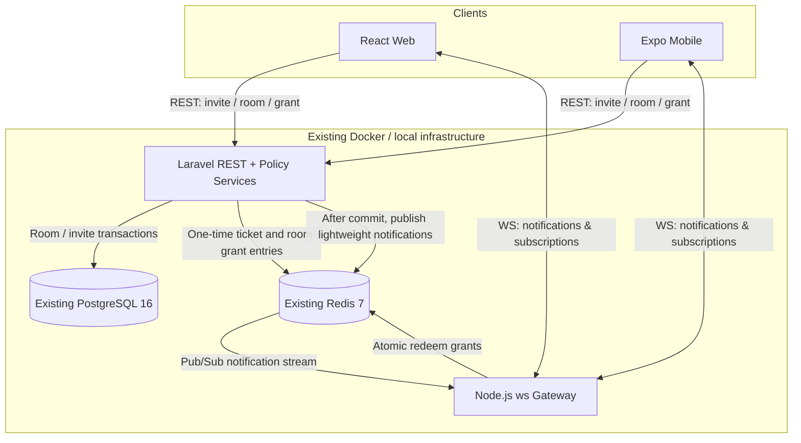
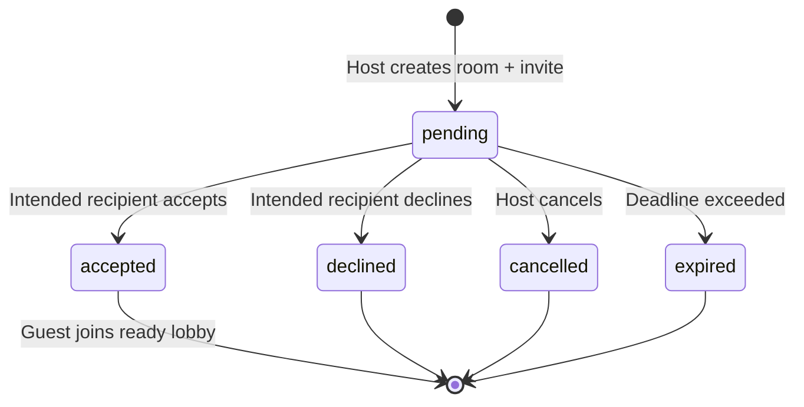
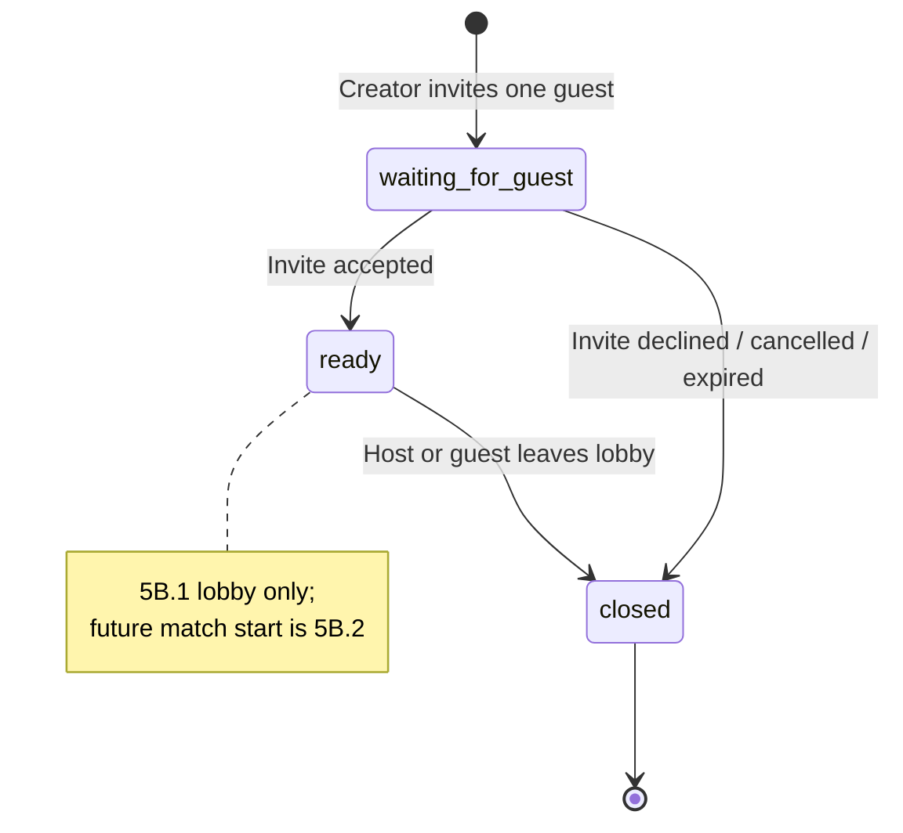
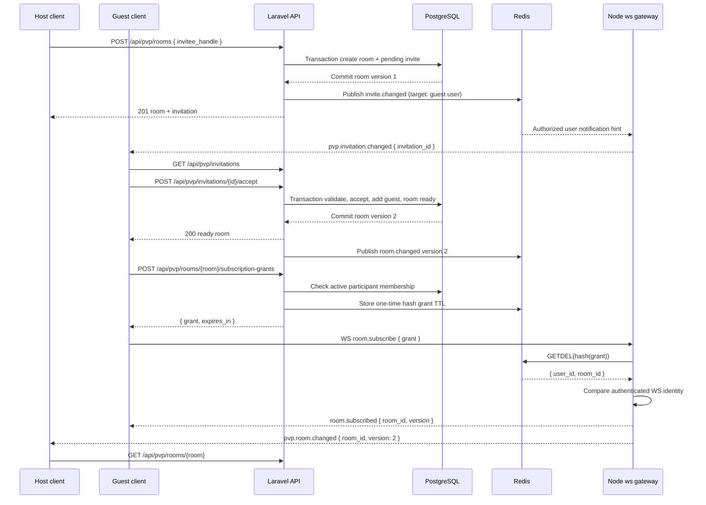

# Battle Arena — Phase 5B: Private PvP Rooms, Invitations & Multiplayer Roadmap

**Document status:** Design / implementation contract (not evidence of completed functionality)  
**Version:** 0.1-draft  
**Date:** 2026-11-25  
**Primary location:** `battle-arena-api/docs/PHASE5B_PVP_PRIVATE_ROOMS_SPEC_EN.md`  
**Immediate implementation scope:** **Phase 5B.1 only** — invitations, private lobbies, authorized realtime subscriptions, and basic Web/Expo flows.  
**Reserved for later:** **5B.2** human-vs-human combat and **5B.3** full PvP UX/resilience/balancing.

> **Non-negotiable:** Laravel is authoritative for account identity, invitation eligibility, room membership, player progression, creature ownership, battle state, damage, outcomes and XP. Node.js only provides authenticated, authorized realtime delivery. Redis is a transport/ephemeral coordination service. PostgreSQL remains the durable source of truth. Do not expose hidden battle actions over WebSockets.

## 0. How Cursor must use this document

1. Read **all** of this document and `docs/PHASE5A_REALTIME_NODE_WEBSOCKET_SPEC_EN.md` (the most recent revision, if present). Read `docs/BATTLE_ENGINE_PVE_SPEC_EN.md` for game-engine boundaries, not to implement PvP yet.
2. Inspect the **local working trees and uncommitted changes**, not just GitHub remote HEADs. Phase 5A API and Compose work may be present locally but absent remotely. **Never overwrite them or assume they are missing.**
3. Inspect `.cursor/rules/*.mdc` in **all five sibling projects**, especially the standalone Node service. Preserve and extend its existing `00`–`70` rules, rather than recreating them.
4. Complete only the **5B.1** acceptance criteria in §14. Do **not** silently start the 5B.2 combat engine or 5B.3 matchmaking.
5. Maintain five UI locales: `en`, `fr`, `pt-BR`, `it`, `es`. Use stable machine-readable errors and event names. Do not hardcode translated strings into persisted events.
6. No destructive database operations, no volume deletion, no automatic commit/push, and no new remote repository without explicit instruction.
7. If the source code disagrees with a proposed filename/field, adapt to existing conventions and record the difference. Do not break 5A `connection.ready` or the PvE engine.

## 1. Verified baseline vs. handoff

### 1.1 Baseline inspected in the GitHub repositories

- **Laravel API** (`battle-arena-api`): Sanctum web-cookie/mobile-bearer authentication, `PlayerProfile.handle` stored lowercase, `PlayerProgress.level`, level-6 PvP eligibility policy, battle-engine code for PvE, and configurable PvP reward values (`win=20`, `loss=10`). **These values are not earned until PvP gameplay is actually implemented.**
- **Node gateway**: independent local directory `battle-arena-realtime`; remote repository is `battle-arena-realtime-websocket`. Uses native `ws`, TypeScript, Redis one-time tickets, `connection.ready`, `connection.error`, heartbeat, limits, strict client frame parsing, health endpoints, and `.cursor/rules/00`–`70`. Protocol version `v: 1` uses `{ v, type, event_id, sent_at, payload }` for server-to-client frames.
- **Infra**: existing sibling `battle-arena-infra`, central `compose.yaml`, one Redis and one Postgres, independent bind-address variables; DB/Redis default localhost and must never be exposed to LAN.
- **Web & Mobile**: React and Expo app with i18n; existing PvE gameplay and sound. No need to redesign these screens for 5B.1.

### 1.2 Handoff claims requiring local verification

Per the Phase 5A handoff, an authenticated `POST /api/realtime/tickets` endpoint, `ws_tickets` Redis connection with an empty prefix, and Docker Compose `realtime` service exist **locally** but were not yet pushed to API/infra repositories. Cursor must verify this work before modifying anything. A remote listing alone is not proof the local patches do not exist.

The Phase 5A handoff reports 26 Node tests, six Laravel ticket tests, and local Docker smoke verification. **This document does not claim those tests were rerun.** Rerun relevant checks during 5B.1.

## 2. Intended architecture



**Do not** make WebSockets a new game API: game actions, invitation mutations, and future battle decisions remain HTTP REST. WebSockets provide a low-latency hint to re-fetch authoritative state.

## 3. Milestones and release boundaries

| Milestone | Scope | Build now? |
| --- | --- | --- |
| **5B.1** | Private room creation, exact-handle invitation, inbox, accept/decline/cancel, 1:1 lobby, subscription grants, user-targeted notifications, web/mobile lobby UI | **YES** |
| **5B.2** | Two-human turn engine, battle state/events, room-to-match transition, XP from verified results, attack/defense REST, private state notifications | **NO** |
| **5B.3** | Refined PvP arena, reconnection and timeout/forfeit UX, audio polish, additional device smoke/e2e | **NO** |
| Later | Matchmaking, public rooms, ranked ladders, seasons, spectators, teams, chat, friends, tournaments | **NO** |

### Definition of "room" for 5B.1

A room is a **private two-player lobby**, not a running battle. A creator invites one specified user by exact public handle; the invited user may accept or decline. Upon acceptance both can see a `ready` lobby. **No live PvP combat occurs in 5B.1**, and no XP or win/loss records are modified by lobby actions.

## 4. Product rules — Phase 5B.1

- Both creator and invitee must be authenticated. The same user cannot invite themselves.
- Both must be **trainer level 6 or above**, using the existing backend PvP eligibility policy, verified on room creation and invitation acceptance. A server may reject ineligible users without revealing private details about them.
- Invitation recipient is resolved by normalized, exact `PlayerProfile.handle` on Laravel; never from the websocket's `player_id` input. Do not implement unrestricted user search.
- **Online opponents (additive):** `GET /api/pvp/online` may list PvP-eligible trainers currently connected to the realtime gateway. Presence is **authenticated app session + PvP min level**, not “must be on the PvP lobby screen”. See `docs/ADR_2026_11_26_PVP_ONLINE_PRESENCE_POLICY.md`. Inviting still uses `POST /api/pvp/rooms` with an exact handle (from the list or typed).
- Each room supports exactly one host and one guest for the MVP. No spectators, public joins or multiple concurrent invitations within one room.
- Creation, invitation acceptance, rejection, cancellation, expiration and closure must have explicit authorized transitions and produce auditable records.
- An invitation may be accepted only by the intended recipient, once, before expiry, while the room remains available. Hosts cannot accept on behalf of guests.
- A user cannot simultaneously enter conflicting private room states; enforce whichever **configurable** capacity policy the current architecture supports (recommended MVP: one non-closed lobby per user). Guard with transactions and database constraints/locking.
- Inviting is opt-in; the receiver decides whether to join. No automatic PvP start on invite acceptance.
- Invites should expire: **proposed initial TTL 10 minutes**, configurable, not an established gameplay rule. Expiration must be enforced when commands are executed, not merely by scheduled cleanup.
- Rate-limit creation, invitations, and subscription-grant issuance; provide generic failure responses that avoid leaking hidden trainer information.
- Keep profile handle/name/avatar exposure within existing public-profile policies. Never expose email, private collection data, access tokens, ticket material, or opponent private data.
- On leave/cancel in 5B.1, close the lobby without assigning a combat win/loss or XP. PvP forfeit/disconnect/timeout outcomes remain **undecided for 5B.2/5B.3**.

### Invitation lifecycle



### Room lifecycle



**Implementation nuance:** Use separate DB state machines for invite and room to avoid contradictory states. Persist timestamp and transition reason. Do not allow stale clients to mutate an already-transitioned entity.

## 5. Data model (additive PostgreSQL migrations)

Names are proposed; inspect existing conventions first.

### `pvp_rooms`

| Column | Description |
| --- | --- |
| `id` | UUID/ULID primary key (opaque public identifier) |
| `host_user_id` | FK users; owner |
| `status` | `waiting_for_guest`, `ready`, `closed` |
| `version` | Positive monotonic integer for optimistic concurrency |
| `closed_reason` | nullable server enum (`cancelled`, `declined`, `expired`, `left`) |
| `created_at`, `updated_at`, `closed_at` | timestamps |

### `pvp_invitations`

| Column | Description |
| --- | --- |
| `id` | UUID/ULID primary key |
| `room_id` | FK pvp_rooms |
| `inviter_user_id` | host FK |
| `invitee_user_id` | intended recipient FK |
| `status` | `pending`, `accepted`, `declined`, `cancelled`, `expired` |
| `expires_at` | expiry enforced on every transition |
| `responded_at`, `created_at`, `updated_at` | timestamps |
| `idempotency_key` | request identity (scope per actor/operation) |

### `pvp_room_members` (or a justified equivalent)

| Column | Description |
| --- | --- |
| `room_id`, `user_id` | FKs; composite uniqueness |
| `role` | `host`, `guest` |
| `joined_at`, `left_at` | membership lifecycle |

Required invariants: 1 host, at most 1 accepted guest; recipient must match pending invitation; no duplicate active membership; no double acceptance; cascading deletes must not erase audit history unexpectedly; uniqueness and indexes on active/pending operations. Validate status constraints and foreign keys. Use concurrent integration tests, especially for acceptance and cross-room membership.

**Strong preference:** Store only authoritative lobby state in Postgres. Redis is not the system of record for room existence or membership. Do not use an in-memory `Map` in Node as the sole source of who is allowed in a room.

## 6. Laravel REST API — proposed contracts

All `/api/pvp/*` endpoints require `auth:sanctum`, FormRequests, policy authorization, thin controllers, Resources, standardized localized error envelopes and rate limits. Align exact paths and envelope with existing conventions.

| Method | Endpoint | Actor | Effect |
| --- | --- | --- | --- |
| `POST` | `/api/pvp/rooms` | Host (level >= 6) | Create private room + invite by exact handle |
| `GET` | `/api/pvp/invitations?box=received` | User | Inbox, bounded/paginated |
| `GET` | `/api/pvp/invitations?box=sent` | User | Sent invitations, bounded/paginated |
| `POST` | `/api/pvp/invitations/{id}/accept` | Recipient only | Join as guest; room becomes ready |
| `POST` | `/api/pvp/invitations/{id}/decline` | Recipient only | Mark declined; close waiting room |
| `POST` | `/api/pvp/invitations/{id}/cancel` | Host only | Cancel pending invite; close room |
| `GET` | `/api/pvp/rooms/{room}` | Active participant only | Current lobby/membership/version |
| `POST` | `/api/pvp/rooms/{room}/leave` | Member only | Close lobby, no XP |
| `POST` | `/api/pvp/rooms/{room}/subscription-grants` | Active participant only | Issue short-lived one-use room grant |

`GET /api/pvp/invitations` is user-scoped, never a global invite index. `GET /api/pvp/rooms/{room}` must return 404/403 according to existing non-enumeration conventions and must never show an unrelated private room.

### Example create room (illustrative)

```http
POST /api/pvp/rooms
Content-Type: application/json
Idempotency-Key: 746fc8a7-25a2-4a1d-b183-192877559fcc

{"invitee_handle":"othertrainer"}
```

```json
{
  "data": {
    "room": {"id":"room-opaque-id","status":"waiting_for_guest","version":1},
    "invitation": {"id":"invite-opaque-id","status":"pending","expires_at":"2026-11-25T22:20:00Z"}
  }
}
```

All IDs/timestamps above are examples; implement actual UUIDs/serialization. `Idempotency-Key` should protect all mutating requests or use another strong documented equivalent. Retries must return prior results, not create duplicate rooms.

### Example acceptance

```http
POST /api/pvp/invitations/{invitation-id}/accept
Idempotency-Key: 8b4742b8-495f-44b6-bc3c-fb1c5f274f7a
```

The transaction locks invitation and room, confirms recipient/expiry/eligibility and pending status, inserts guest membership once, updates both entities and increments room version. Publish notifications **after commit**, never before. Handle concurrent double-accept, expired invite, removed membership and already-closed room deterministically.

### Serialization guidance

Room response: opaque ID, status, version, host/guest public display identity (handle/display name/allowed avatar URL), joined/created timestamps, allowed actions for requesting user, and pending invitation summary where appropriate. Do not send `email`, exact access tokens, or unrelated player data. A profile's visibility settings must still be respected.

Invitation response: opaque IDs, status, expiry, minimal public inviter/recipient details, and allowed actions. Do not include hidden opponent trainer attributes if eligibility check fails.

## 7. WebSocket authorization: **a connection ticket is NOT a room grant**

### Why a separate authorization capability?

Phase 5A `connection.ready` proves only that a WebSocket belongs to a Laravel-authenticated player. It does **not** grant access to arbitrary rooms. Never accept a client frame such as `{ "room_id": "...", "player_id": 123 }` as proof of membership.

### Selected design for Phase 5B.1: one-use Laravel room subscription grant

1. Client authenticates to Laravel as it already does (web cookie + CSRF, Expo bearer).
2. Client establishes WS using the existing 5A `POST /api/realtime/tickets` flow and receives `connection.ready` with server-derived `player_id`.
3. Client calls `POST /api/pvp/rooms/{room}/subscription-grants` **over authenticated REST**. Laravel checks active membership from PostgreSQL, room status, account eligibility and permissions.
4. Laravel generates a 256-bit random single-use grant and writes **only its SHA-256 hash-derived key** to the existing Redis using an isolated prefix such as `battle-arena:ws-room-grant:` with **proposed TTL 30 s**. Stored metadata: `room_id`, `user_id`, issued/expiry timestamps, and optional membership/version binding. Do **not** reuse the 5A connection ticket key prefix.
5. Client sends the grant **inside the already-authenticated WSS connection**, never in a URL. Example `room.subscribe` frame contains the grant only, not an authoritative user ID or open room ID.
6. Node atomically consumes via Redis `GETDEL`, validates schema/expiry, and ensures `grant.user_id === authenticatedSocket.playerId`. It binds the specific socket to the authorized `room_id` and returns `room.subscribed`.
7. Node never queries PostgreSQL directly. Laravel remains the only membership authority.
8. On room close/membership revocation, Laravel emits a trusted after-commit invalidation notification; Node must remove affected subscriptions. If Redis subscription/event delivery becomes uncertain, **fail closed** for private room fanout and require fresh authorization before resuming.

### Sequence diagram



**Note:** host must also obtain its own grant to subscribe to a private room. The host can receive personal notifications without room subscription. Do not assume that user-targeted notifications imply room membership.

### Revocation and logout

A room can close while a socket stays connected. Node must revoke room subscriptions when membership is no longer valid. 5A long-lived connection tokens can outlast logout/revocation; define a concrete revocation mechanism for the gateway (e.g., API-authenticated control signal, token/session invalidation events, or short connection maximum lifetime + forced revalidation) and test it. Do not claim a socket immediately loses authorization upon Laravel logout unless the mechanism actually enforces this. Room permissions must **never** be granted solely from a cached user ID.

## 8. Protocol v1 extensions — proposed

**Preserve** Phase 5A frame envelope and `connection.ready` / `connection.error` behavior.

### Client-to-server frames

```json
{"v":1,"type":"room.subscribe","request_id":"req-uuid","payload":{"grant":"opaque-one-use-grant"}}
```

```json
{"v":1,"type":"room.unsubscribe","request_id":"req-uuid","payload":{"room_id":"opaque-room-id"}}
```

`room.unsubscribe` can reference a room ID because it only removes a subscription from the caller's own socket. **It cannot grant access.** Reject extra keys, binary frames, oversized payloads, unsupported message types, and invalid JSON.

### Server-to-client frames

```json
{
  "v":1,
  "type":"room.subscribed",
  "event_id":"event-uuid",
  "sent_at":"2026-11-25T22:20:00Z",
  "payload":{"room_id":"opaque-room-id","version":2}
}
```

```json
{
  "v":1,
  "type":"pvp.room.changed",
  "event_id":"event-uuid",
  "sent_at":"2026-11-25T22:21:00Z",
  "payload":{"room_id":"opaque-room-id","version":3}
}
```

```json
{
  "v":1,
  "type":"pvp.invitation.changed",
  "event_id":"event-uuid",
  "sent_at":"2026-11-25T22:21:00Z",
  "payload":{"invitation_id":"opaque-invite-id"}
}
```

```json
{
  "v":1,
  "type":"room.subscription.revoked",
  "event_id":"event-uuid",
  "sent_at":"2026-11-25T22:21:00Z",
  "payload":{"room_id":"opaque-room-id","reason":"room_closed"}
}
```

Use `connection.error` with **stable error codes** for invalid/reused/expired grants, authorization mismatch, rate limits, unsupported messages and Redis unavailability; do not echo submitted secrets or identifiers from invalid commands. All frames must have bounded payloads and stable runtime validation (e.g., Zod). Keep `request_id` correlation where applicable without treating it as authorization. Never send full player, hidden battle, or credential data over pub/sub or room notifications.

### Personal notifications vs. room notifications

- `pvp.invitation.changed` is sent only to authenticated **involved users** (invitee and/or inviter, as appropriate) via a user-targeted channel, not broadcast globally.
- `pvp.room.changed` is sent only to sockets with active **authorized room subscriptions**.
- Version numbers increase in Laravel transactions. Node relays them; it does not invent, decrement, or assume total ordering across server instances.

### Notification delivery semantics

- Redis pub/sub is **best effort** and not durable. It is acceptable for lobby notifications if the clients rehydrate using REST on reconnect and when becoming active.
- Publish only after successful DB commit; if reliable eventual publication becomes necessary, use an outbox worker (not a second DB). Document the trade-off rather than pretending in-memory callbacks guarantee delivery.
- Duplicate/stale notifications are expected: clients deduplicate by `event_id` and compare `version`; on version gap or unknown state, re-fetch REST. Never apply authoritative membership changes solely from websocket data.
- Implement backpressure, per-connection subscription limits, rate limits, and Redis disconnect behavior. Do not leak private data on reconnect.

## 9. Redis conventions and containers

- Reuse existing Redis 7. Do **not** add a second Redis instance.
- Keep 5A ticket key contract unchanged: `battle-arena:ws-ticket:{sha256(ticket)}` with the existing `ws_tickets` Laravel connection and **empty prefix**.
- Room grants use their own prefix / TTL; ensure both Laravel and Node interpret prefixes identically. Test with the real Compose Redis configuration.
- Example reserved realtime channel: `battle-arena:realtime:notifications:v1`. Publisher is backend-only; subscribers parse and validate an explicitly typed envelope. Prefer targeted messages with server-supplied `target_user_id` or `target_room_id`, never broad fanout.
- Redis must stay on private Compose network, with published port bound to `127.0.0.1` independently of `REALTIME_BIND_ADDRESS`.
- Preserve `realtime` service and local sibling build context (`../battle-arena-realtime`). Do not introduce Socket.IO, Reverb, a new database, or a second WS server.
- Production deployment must use TLS/WSS, trusted reverse proxy, correct `Origin` controls, and no credential logging.

## 10. Cursor rules — extend, do not regenerate

The Node project already has:

```
.cursor/rules/
  00-project-architecture.mdc
  10-typescript-node.mdc
  20-websocket-protocol.mdc
  30-authentication-security.mdc
  40-redis-reliability.mdc
  50-testing-quality.mdc
  60-docker-deployment.mdc
  70-observability-errors.mdc
```

Review and preserve existing rules. Extend where necessary and introduce **one targeted rule** if it improves clarity:

`80-private-rooms-and-fanout.mdc` (or merge into existing appropriate rules) enforcing: Laravel-only membership authorization, one-use subscription grants, per-connection authorized subscriptions, no client-controlled recipient IDs, no room broadcast to outsiders, no combat calculations/XP in Node, Redis best-effort notification semantics, REST rehydrate, and deny-by-default failure behavior.

Use valid `.mdc` frontmatter, appropriate `globs`, and concise enforceable instructions. Check equivalent rules in API/infra/web/mobile and update only if needed. Never replace existing rules with generic templates.

## 11. Web and Expo scope (5B.1 only)

### React Web

- Minimal **PvP entry/lobby page**, not a full battle arena.
- Create a private invitation by exact handle; view sent/received invitations, status and expiry; accept, decline or cancel; see a ready lobby with the two participants.
- Establish authenticated WS through existing 5A ticket API; request per-room grant over REST only when eligible/authorized; show connection state.
- On `pvp.invitation.changed` / `pvp.room.changed`, fetch authoritative REST resources; support reconnect with fresh connection and room grants.
- Display loading/error/empty states and deduplicated optimistic/disabled submit handling; do not fake presence or private data. Avoid new heavy dependencies.

### Expo Mobile

- Equivalent minimal private invite/lobby flow in a native Expo Router screen.
- Reuse existing bearer-token auth without putting the bearer into the WS URL. Obtain fresh REST WS ticket and room grant.
- Respect app foreground/background transitions, safe areas, cancellation, network changes, and native Origin policy established in 5A.
- Restore state through REST; when app resumes, reacquire room authorization, do not assume a cached socket proves membership.

### Both clients

- Existing five locales: `en`, `fr`, `pt-BR`, `it`, `es`; all visible strings and status/error messages translated.
- UI may display invited trainer's public handle/avatar, but no email or other restricted profile fields.
- No PvP combat buttons, XP banners, win/loss scores, or fake real-time attacks in 5B.1. Show honest status such as **Private lobby ready — battle mode coming in a later phase**.
- Keep public Game Rules `pvp` **not playable**. If adding a separate feature flag for invitations/lobbies, avoid changing the existing `features.pvp=false` before full combat ships.

## 12. Failure cases and security requirements

| Scenario | Required outcome |
| --- | --- |
| Unauthenticated room/invite API | 401; no mutations |
| Trainer below level 6 creates / accepts | denied by Laravel policy |
| Invite self | rejected |
| Unknown / unavailable handle | safe generic error; no sensitive account info |
| Non-invitee accepts or declines | deny, no mutation |
| Non-host cancels pending invitation | deny |
| Two accept requests race | one membership/transition, safe replay |
| Invitation expired | cannot accept even before cleanup job runs |
| Room already closed | no resurrection |
| Duplicate POST retry | no duplicate room/invite or event; idempotent response |
| Foreign user requests room REST state | deny with no data leakage |
| Authenticated socket subscribes without room grant | deny |
| Socket uses grant for another user | deny, do not subscribe |
| Socket reuses or presents expired grant | deny; redis `GETDEL` |
| Client submits `room_id` / `player_id` claiming authority | ignore/reject, never trust |
| Host/guest leaves | room closed; all subscriptions revoked |
| Redis unavailable at grant validation | fail closed, no private fanout |
| Duplicate/out-of-order WS notification | REST reconciliation; no extra side effects |
| Web refresh/mobile restart | room/invites restore via authenticated REST |
| Malformed/oversized WS frames | reject with safe protocol error |
| Invite spam | throttle and max pending policy |
| Laravel logout while WS remains active | documented and tested revocation/revalidation behavior |

## 13. Implementation sequence — Phase 5B.1

**P0 — Reconcile prerequisite changes.** Verify locally implemented 5A ticket route and Compose service; check latest CI for API, Node, infra, web and mobile. Do not commit/push without permission. Preserve working tree. Resolve necessary 5A compatibility gaps before proceeding.

**P1 — Laravel persistence and policies.** Add migrations, models, state transitions, FormRequests, policy checks, creation/inbox/accept/decline/cancel/leave services, idempotency/concurrency and API Resources. Tests first for ACL, race conditions, expiry, retry, and level gate.

**P2 — Room subscription authorization.** Add authenticated Laravel room-grant endpoint and atomic Redis one-time grant storage. Extend Node frame schema and connection registry with room subscriptions. Verify user binding, one-use, expiry, logout/revocation trade-offs, and failure-closed Redis handling.

**P3 — Notifications.** Implement Laravel after-commit domain event publication and bounded typed Redis notification consumer on Node; only target appropriate users/rooms. Add versioning, deduplication recommendations, fanout and revocation tests.

**P4 — Web/Expo lobby.** Minimal PvP invite and lobby interfaces, websocket clients with ticket/regrant logic, REST rehydrate, all five locales, responsive/native interaction and error states. Do not build battle screen.

**P5 — Final validation.** Lint/typecheck/build/test per repo; API feature/integration tests, Node ephemeral WS integration, Docker smoke for two distinct authenticated accounts, and web/mobile tests. Clearly label which runtime platforms were not actually tested. Update docs/Swagger/README/feature flags truthfully.

## 14. Phase 5B.1 Definition of Done

- [ ] Existing 5A ticket handshake continues working; unauthed/reused tickets still rejected.
- [ ] Eligible trainer can invite one other exact-handle trainer into a private lobby.
- [ ] Level < 6, self-invites and unauthorized users cannot create/accept invitations.
- [ ] Intended recipient sees invite, can accept or decline; host can cancel; expiry enforced.
- [ ] Acceptance puts exactly two authorized users into a `ready` lobby; no third party can join.
- [ ] Concurrent and retried mutations do not duplicate invitations/memberships.
- [ ] Both participants can request current lobby state through REST; unrelated users cannot.
- [ ] Laravel issues single-use room subscription grants; Node validates identity and consumes grant once.
- [ ] Node relays correctly targeted, versioned lobby/invite notification hints only after DB commit.
- [ ] Closing a lobby revokes room fanout; Redis failures fail closed.
- [ ] Both Web and Expo expose working invitation/lobby experiences without simulated battle data.
- [ ] Refresh/reconnect rehydrates from REST and obtains fresh tickets/grants.
- [ ] All five locale catalogs are updated and key parity checked.
- [ ] `features.pvp` remains false and no PvP XP or win/loss stats change.
- [ ] CI and applicable tests **actually executed** and results reported. Manual phone testing is not claimed unless performed.
- [ ] No destructive migration, data reset, new database or secret leakage.
- [ ] No automatic commit or push.

## 15. Phase 5B.2 design direction — **DO NOT IMPLEMENT IN 5B.1**

The existing pure PvE `BattleEngine` is reusable in principle, **but** its current `CombatSide::Player`/`Opponent` and `BattlePhase::AwaitingPlayerAttack`/`AwaitingPlayerDefense` plus AI-selected committed attack embody **PvE assumptions**. Do not merely let two clients call the PvE endpoints. Instead, when starting 5B.2:

1. Design a player-neutral two-human turn state machine, with server-determined initial attacker and a fair initiative rule to be explicitly approved. Avoid inventing first-turn priority or tie-breaking now.
2. Both participants choose legal actions over authenticated Laravel REST; server validates identity, ownership, room membership, action authorization, phase and expected version.
3. Ensure the defender can view only the information intended to be disclosed before reaction; no hidden RNG, pending attacks or future state leaked to the non-acting player.
4. Keep immutable combatant snapshots, deterministic RNG, authoritative damage/resource calculations, transaction locks, idempotency, event history and replay.
5. After DB commit, emit only `pvp.battle.changed` with match ID and version to authorized room members; clients query authorized REST for full state.
6. Apply existing trainer-level gate >=6 and configured **PvP reward targets +20 win / +10 loss for completed combat**, via server-verified result and exactly-once award. **Forfeit, disconnect, inactivity, abandoned matches and draws are not yet defined; do not invent XP rules.**
7. Model reconnect/timeout semantics deliberately. Distinguish temporary offline status from match forfeit; do not lose a game because a user refreshed a tab.
8. Keep Node as delivery-only; never copy damage, XP or match outcome logic to Node.

## 16. Phase 5B.3 design direction — **DO NOT IMPLEMENT IN 5B.1**

- Build React/Expo 1v1 multiplayer battle screens using existing PvE visual components where compatible, without sharing hidden opponent state.
- Provide turn notifications, attack/defense prompts, readiness, reconnect recovery, graceful latency handling, and responsive accessible interface.
- Decide and document fair timeout/forfeit/abandon/disconnect rules before implementing rewards.
- Use five-language event narration and preserve sound settings, reduced-motion controls and user-facing errors.
- Add adversarial tests: opponent cannot play out of turn; no hidden-move leakage; no false winner/XP; no premature battle completion; duplicate frames/actions do not double advance a match.

## 17. Documentation and CI expectations

- Update only appropriate repositories; preserve the five independent repositories (`battle-arena-realtime-websocket` remote name, local directory `battle-arena-realtime`).
- Extend `.cursor/rules` **surgically** in Node and other repos. Add OpenAPI/Swagger endpoints and relevant README examples. Do not create fake endpoints or samples that do not match actual implementation.
- Run Node `npm ci`, lint, typecheck, tests, build; Laravel PHPUnit/Pest suite and style checks; Web Vitest/lint/typecheck/build; Expo lint/typecheck and actual device test only if available. Consult each repo's scripts instead of inventing command names.
- Docker checks use existing Compose. Never run `docker compose down -v`, `migrate:fresh`, `db:wipe`, or change Redis/Postgres bind address to 0.0.0.0.
- The final report must separate: implemented, tests passed, tests failed, not tested, known risks, manual verification instructions, and deferred 5B.2/5B.3 tasks.

## 18. Open product decisions (deliberately deferred)

| Question | Default in 5B.1 | Must decide before 5B.2/5B.3 |
| --- | --- | --- |
| Who attacks first in PvP? | No battle starts | Fair initiative algorithm |
| What does an inactive player lose? | Nothing; lobby can close without XP | Disconnect/timeout/forfeit policy |
| XP on PvP forfeit / draw? | None because 5B.1 has no battles | Explicit outcome/reward specification |
| Can players switch creatures mid-battle? | No combat | Team rules |
| Ranked/unranked matching? | Private invite only | Later release |
| Expiry / max pending invitations | Configurable initial proposal | Playtest/abuse review |
| Connection/session revocation latency | Implement documented safe enforcement | Operational SLA |

**End of Phase 5B design contract. Execute Phase 5B.1 only until explicitly authorized to start 5B.2.**
